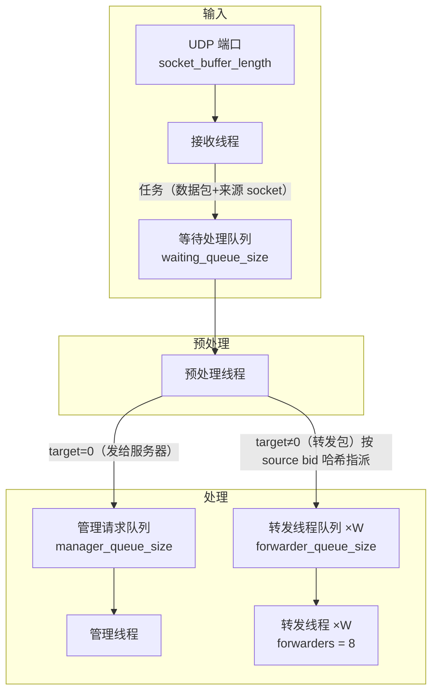
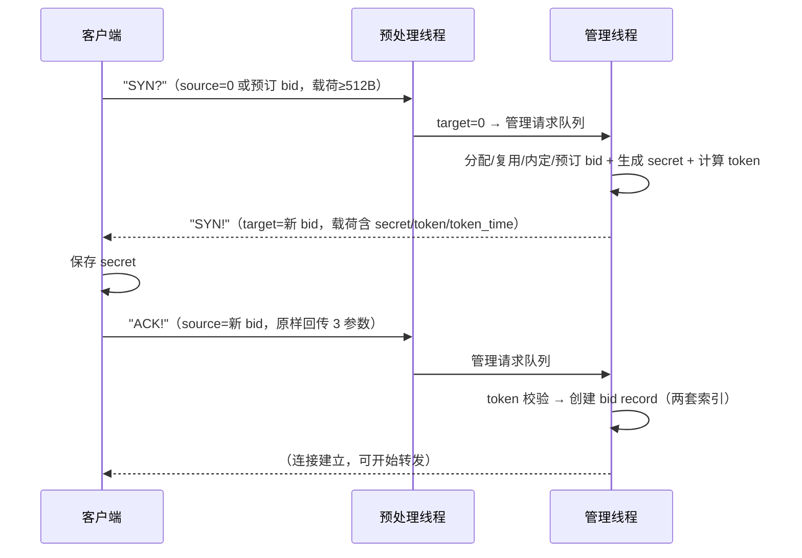
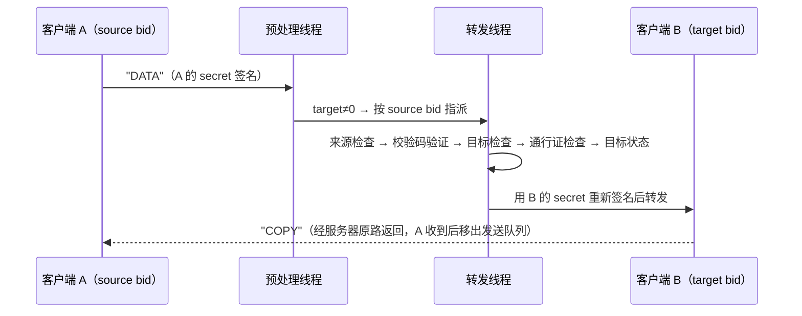

# Magpie Bridge 架构设计

Magpie Bridge 采用 **N:1 的客户端-服务器（C-S）拓扑**。服务器是离散的中继节点：一个服务器可为大量已注册客户端提供转发服务，服务器之间互不关联，客户端按连通速度自行选择服务器。两个客户端若能直连则优先直连，否则通过服务器转发。

本文档合并定义服务器整体架构、各线程职责、内存分配表（bid record）、通行证（Permit）模型与消息流转。

---

## 1. 网络结构

```
        +-----------+         直连（B=0）         +-----------+
        | 客户端 A   | <========================> | 客户端 B   |
        +-----+-----+                            +-----+-----+
              |  UDP 桥接（B=1）                        |
              |                                        |
              v                                        v
        +-----------------------------------------------------+
        |                    服务器 S（中继节点）                |
        |            仅转发已在本服务器注册的客户端                |
        +-----------------------------------------------------+
```

- 客户端向服务器申请 bid（Bridge ID，门牌号）后，其他客户端可根据 bid 请求服务器协助转发；
- 客户端直连不需要 bid，但仍需握手建立"连接"（有向管道）；
- 服务器只为客户端提供最简单的转发服务，不与其他服务器关联。

### 基本转发规则

- 系统指令（D=0）不携带 sn，应答靠 **socket 配对**：从哪个 socket 收到请求，就回哪个 socket；source bid 不决定应答发给谁，仅用于身份校验（验证 bid 与 socket 的绑定关系）；
- 数据包（D=1）：直连（B=0）收件人即对方 socket；桥接（B=1）收件人由 target bid 指定；"COPY" 应答均靠 sn + index 配对；
- 服务器收到 target/source 全非 0 的包才认为是转发包，查询两个 bid 均正确（且两者不等）后，原样转发到 target 对应的 socket；
- source bid 为 0 的包只可能是服务器下发的（客户端伪造会被判定为上行校验违规而丢弃）。

---

## 2. 服务器整体架构

服务器内部逻辑**收发分离**，由多个独立线程协作：



| 线程 | 职责 |
|------|------|
| 接收线程（1） | 从绑定 UDP 端口收包，不做判断，将"数据包 + 来源 socket"封装成**任务**放入等待队列 |
| 预处理线程（1） | 从等待队列取任务，做基础校验（来源 IP、协议头、上行校验违规），按 target bid 分拣给管理线程或转发线程 |
| 管理线程（1） | bid 分配管理、超时记录回收（purge）、通行证管理（ACPT/DENY）、系统指令应答、应用密钥重载 |
| 转发线程（W） | 专门负责转发数据；按 `source bid % W` 指派任务，每线程辖若干 source bid |

> **任务** = 数据包与来源 socket 信息的封装，是队列中的元素（不是裸数据包）。

---

## 3. 预处理线程

从等待列表取出下一个任务：

1. **来源 IP 检查**：广播/多播地址（IPv4 224.0.0.0/4 与 255.255.255.255、IPv6 ff00::/8 等）→ 静默丢弃（不应答、不转发，防放大攻击）；
2. **协议头校验**：Magic Code、由 type 计算的协议头长度 N、`N + payload_length` 与实际长度（含附加校验码判定）、C=1 时 command 非 0、D=0 时 E=0、D=1 时 sn 非 0、E>0 时 `0 <= index < count` 且 count > 1——任一不满足即错误包，静默丢弃；
3. **上行校验违规**：B 必须为 1；target≠0 时 source 不能为 0；target 与 source 不能相等——违规即静默丢弃；
4. **分拣**：
   - target = 0 → 交给管理线程（由管理线程检查 source、command 等）；
   - 其余（target、source 均非 0 且不等）→ 按 `source bid % W` 指派给转发线程。

> 预处理线程不查分配表、不更新活跃时间，只负责分拣。

---

## 4. 管理线程

每个 runloop：

1. **回收检查**：距上次调用超过 `record_recycle_interval`（默认 10 分钟）则调用 `purge(now)` 回收超时记录及其关联的通行证条目；
2. 从管理请求队列取出下一个任务（队列为空阻塞等待）；
3. 按 command 走子流程（详见工作流与安全文档）：
   - "SYN?" → 第一次握手（唯一允许 source bid = 0 的场景）；
   - 除此以外必须 source > 0；
   - "ACK!" → 第三次握手（无状态令牌验证）；
   - **来源检查**：按来源 socket 查询分配表——记录不存在则按"连接未确认"处理（回复 "FAIL" 受共享计数器限频，见安全文档）；socket 记录存在则校验 source bid 与记录一致（不一致 = 伪造来源丢弃）；
   - **附加校验**：除 SYN?/ACK! 外均须通过 HMAC 校验码验证，失败即丢弃；
   - **离线分流**：记录 offline == true 且 command 不属于 "FIN?"/"NOOP"（"SYN?"/"ACK!" 已在前面处理）→ 静默丢弃、不更新活跃时间；
   - 来源检查、附加校验与离线分流全部通过后才更新活跃时间；
   - **指令集过滤**：最后检查 command 是否属于支持的系统指令，未知指令直接丢弃；
4. 全部通过后按 command 值走对应子流程。

> 活跃时间 `record.last_time` 只在**来源检查、附加校验与离线分流全部通过之后**才更新；任何校验失败或离线期间被丢弃的包不得刷新活跃时间，否则伪造包可借此变相保活。

---

## 5. 转发线程（W 条）

服务器启动时安排 W 条转发线程（默认 W=8）。预处理线程按 `n = source bid % W` 指派任务；转发线程内部为每个 source bid 维护一个等待转发队列。

**runloop**（广度优先轮询，避免单用户洪泛干扰他人）：

1. 轮询辖下 source bid，取队首任务（全空则 sleep 后继续）；
2. **来源检查**：记录不存在 → "连接未确认"处理（回复 "FAIL" 受限频）后丢弃；socket 匹配但 source bid 与记录不一致 → 伪造来源，丢弃；
3. **附加校验**：对带校验码的数据包用 `record.secret` 验证，失败即丢弃；
4. **离线分流**：记录 offline == true → 静默丢弃（不更新活跃时间）；
5. 以上检查全部通过后更新活跃时间；
6. **目标检查**：target bid 记录不存在 → 伪造包，静默丢弃；
7. **通行证检查**：发送方是否有权向 target 发送（先在发送方记录、再在 target 记录中查找通行证，任一边查到有效且来源与目标双方的 socket 均匹配即放行），不满足 → 静默丢弃（不暴露收件人存在与接纳状态）；
8. **目标状态**：target 记录 offline 或 `last_time` 超过 `T_active`（在线判定窗口，默认 60 秒）→ 回复 "FAIL" 通知发送方；
9. **完整转发**：用**接收方**的 secret 重新签名（替换原校验码），原样发送给 target 对应 socket。

**流量控制**：滑动窗口限流——每条转发线程在 `forward_window` 秒内最多处理 `forward_limit_per_window` 个任务；超过队列容量（`forwarder_queue_size`）的新任务直接丢弃并记日志（由客户端可靠传输重试）。

---

## 6. 内存分配表（bid record）

服务器在内存中维护一张 bid record 分配表，并为之建立**两套索引**：

1. bid —— 客户端"门牌号"；
2. key —— 客户端 socket 信息字符串 `"{ip}:{port}"`。

bid 与 socket 信息**一一对应**：一个 bid 任何时候只会成功分配给一个 socket；任意 socket 最多只能查到一条 bid 记录。

### 6.1 Record 属性

| 属性 | 说明 |
|------|------|
| bid | 门牌号 |
| key | 客户端索引 `"{ip}:{port}"` |
| socket | 客户端信息（ip, port；类型 SocketAddress） |
| secret | 客户端密钥 |
| last_time | 最后活跃时间 |
| offline | 主动下线标志 |
| allowlist | 通行证列表（经封装接口访问，上限 `allowlist_max_entries` 默认 256；实现见服务器文档） |
| last_noop_time | 最近一次 "NOOP" 时间（安全扩展属性） |

**不变量**：

- bid、key、socket、secret 均为**不变量**，记录一经创建永不改变；
- socket 与记录绑定后**不可迁移**至其他 socket，来源 socket 不匹配一律按冲突/伪造处理；
- 每次收到有效数据包都更新 last_time（仅管理线程与转发线程更新，预处理线程不查表）；
- offline 由 "FIN?" 设置（`noop_immunity_window` 内不设置，见安全文档），由 "ACK!" 幂等分支或 "NOOP" 清除；offline == true 期间仅 "SYN?"/"ACK!"/"FIN?"/"NOOP" 放行，其余指令（含 "PING"、数据包）一律静默丢弃、不更新 last_time。

### 6.2 bid 生成规则

bid 为 32 位无符号整数，采用**全随机**方式生成：在 `0x00010000 ~ 0x7FFFFFFF` 之间取均匀随机整数（高 16 位 H = 1 ~ 32767、低 16 位 L = 0 ~ 65535 的全部组合）。冲突则重新随机，重试 M 次（`bid_allocation_retries`，默认 16）仍冲突则回复 "FAIL"。

- 随机下限 0x00010000 保证不落入 0 ~ 65535 的内定保留区间；
- 随机上限 0x7FFFFFFF 保证不自动分配 H ≥ 32768 的预留区间（该区间仅可能由客户端预订产生）；
- 可用空间约 21.47 亿，正常规模下碰撞概率不足万分之一。

**内定与预订**：

- **内定**：来源 IP 为环回地址（127.0.0.0/8、::1/128）且 source bid = 0 的客户端，直接以端口 port 作为 bid（H=0 保留区间）；
- **预订**：客户端在 "SYN?" 中预设 source bid（非 0）即走预订流程——预订 bid 必须大于 65535（不能预订内定区间），H ≥ 32768 属于预留区间但服务器校验不拒绝。

### 6.3 分配与回收

- 握手**无状态**："SYN?" 阶段只做分配决策并计算令牌 token，**不创建任何记录**；记录在 "ACK!" 验证通过后才创建（创建即已确认，secret 固定不变）；
- **容量上限**：新建记录前须检查记录总数已达 `max_records`（默认 65536）——"SYN?" 分配阶段预检、"ACK!" 创建记录前终检（防 "SYN?"~"ACK!" 期间被占满），已达上限回复 "FAIL"；仅内定流程（loopback）豁免；已存在记录的复用/重握手不受影响；
- 创建记录时同时建立 bid 与 socket 两个索引；
- **purge 回收**：`last_time` 超过 `record_expires`（默认 24 小时）的记录由管理线程周期回收（`record_recycle_interval`，默认 10 分钟），先反向清理所有引用被回收 bid 的通行证条目（对方记录中的残留条目，见 8 节）再删除记录（同时删除两个索引）；收集无锁（记录分配表结构仅管理线程增删），逐条删除持短锁；记录数仍 ≥ `max_records × 0.8` 时，回收阈值逐轮减半至 `record_active_timeout`（60 秒），仍超限则判定高负荷（紧急自救，见服务器文档 6.3）；
- **不做惰性回收**：按 bid/socket 查询分配表时不检查是否过期，记录存在即按有效处理；过期回收统一由 purge 完成。

### 6.4 服务器密钥与 Token

- **服务器密钥 server_secret**：仅用于生成/校验 Token，只保存在服务器内存，10 分钟轮换一次（`server_secret_rotate_interval`），保留最近 2 个密钥用于校验；
- **客户端密钥 secret**：服务器生成，通过握手发给客户端，握手成功后所有系统指令用此密钥签名/验签；在 record 生命周期内永不改变；
- 两种密钥均须用密码学安全随机数生成。

**Token 生成**：

```
1. 取得 bid（新建/内定/预订/复用）十进制正整数
2. 取得 secret（复用则取原 record.secret，否则随机生成，Base64 编码；加密模式下以加密后的密文 ciphertext 作为参与计算的 secret，见协议文档）
3. 观察得到客户端 socket "{ip}:{port}"
4. 取服务器当前时间戳 time（秒）
5. 按 key 字典序排序合并 "bid={bid}&secret={secret}&socket={socket}&time={time}"
6. 取最新 server_secret 计算 HMAC-SHA256，Base64 编码
```

**Token 校验**：取协议头 source bid、观察到的 socket、载荷 "secret" 与 "token_time"，重算并逐个与全部服务器密钥（最多 2 个）比对，任一匹配即通过。

---

## 7. 消息流转时序

### 7.1 握手（客户端 → 服务器）



### 7.2 数据转发（客户端 A → 服务器 → 客户端 B）



---

## 8. 通行证（Permit）

通行证是双方的"发送许可"，为**双向同意关系**（详细流程见工作流文档）。服务器转发数据包前，须确认发送方有权向 target 发送。

### 8.1 添加流程

ACPT 可携带多个 bid，按错误类型分类处理：

- **格式类错误**（bid 为负数、0、或等于发起方自身 bid）——客户端编码错误，整体拒绝（不处理任何 bid），回复 "FAIL"（载荷 sources 回显格式非法的 bid 子集）并丢弃此指令；
- **状态类错误**（bid 记录不存在、allowlist 空间不足）——逐条跳过，仅该条不执行，继续处理其余 bid，最后在应答中回显未成功的 bid 子集。

对通过的 bid 逐个执行以下添加流程（客户端 A 为 B 添加，bid 分别为 X、Y）：

```dart
// 先在 A 的记录中查找属于 B 的通行证
var permit = X.record.searchPermit(Y);
if (permit != null && permit.match(Y.record)) {
    // 通行证已存在且目标未变（此通行证必含对 B 的授权）
    // 无需更新，直接返回
    return permit;
} else {
    // 本地通行证不存在或已陈旧（目标 bid 换持有者/持有者换网）
    // 清理陈旧条目后按下方流程处理
    X.record.removePermit(Y);
}
// 本地通行证不存在，则在 B 的记录中查找属于 A 的通行证
permit = Y.record.searchPermit(X);
if (permit == null) {
    // 如果仍然不存在（正常情况下是因为 A 先发起 ACPT）
    // 则新建一个属于 B 的通行证（含对 B 授权）
    permit = Permit(Y.record);
} else if (permit.match(X.record)) {
    // 如果存在（通常是因为 B 先发起 ACPT，此时已含对 A 的授权）
    // 则添加对 B 的授权
    permit.accept(Y.record);
    // （注意：此时 B 侧引用立即生效）
} else {
    // 陈旧通行证（发起方 bid 换持有者 / 持有者换网）
    // 清理后重建
    Y.record.removePermit(X);
    permit = Permit(Y.record);
}
// 空间足够时写入 A 的记录表（空间不足由 insertPermit 返回 null 表示失败）
if (X.record.insertPermit(Y, permit) == null) {
    // A 的记录表空间不足，无法写入
    return null;
}
// 写入成功，返回此通行证
return permit;
```

> 通行证访问一律经封装接口（`searchPermit`/`insertPermit`/`removePermit`/`clearPermits`/`allowAll`/`isAllowAll`），不直接读写 allowlist 字段；实现见服务器文档。

全部处理完后：

- 存在失败条目 → 回复 "FAIL"（sources 回显**未成功的 bid 子集**）；部分成功时不另发 "DONE"，成功条目由客户端以请求列表减去失败子集得知（或直接忽略、仅重试失败子集）；
- 全部成功 → 回复 "DONE"（sources 回显**实际写入的 bid 列表**）。

> 将"修改 Permit"放在"写入 A 侧 allowlist"之前是有意为之：`accept` 修改的是双方共享对象（B 侧引用立即生效）；若 A 被攻击（allowlist 已满），写入 A 侧会失败，但 B 侧 permit 已生效——只要 B 侧存在共享 permit，A 仍可通过 B 侧的有效通行证与 B 正常通讯；空间不足时该条跳过（A 侧不写入），但 B 侧已生效的修改保留，客户端收到 "FAIL" 后仅需对失败子集重试（幂等）。

### 8.2 删除流程

服务器收到 "DENY" 时，先判断载荷是否为清空标记（见 8.3），命中则走清空流程；否则检查 bid 合法性：

- **格式类错误**（负数、0、或等于发送者自身 bid）——整体拒绝，回复 "FAIL"（sources 回显格式非法的 bid 子集）；
- 其余逐个在发起方记录中删除映射（`X.record.removePermit(Y)`）；目标记录不存在也视为删除成功（幂等）。

全部处理完（无格式类错误）后回复 "DONE"（sources 回显**实际删除的 bid 列表**）。

通行证为双向同意关系：

- 单方 "DENY" 仅在**发起方**记录中删除映射（`X.record.removePermit(Y)`），对方记录中的有效通行证仍在，通信不受影响（防伪造删除）；
- 彻底解除需**双方均 "DENY"**；单方拒收（拉黑）由应用层处理；
- 一方记录被回收后，引用其 bid 的通行证条目由 purge 一并清理（含对方记录中的残留条目），服务器因取不到目标记录不再转发，关系彻底失效。

### 8.3 清空通行证（"DENY *"）

为状态重置（应用重启丢失列表、或被恶意打满时重建）设计特殊 DENY 载荷 `[1, 2, 3]`（严格按序的 3 个有序小正数，防客户端误操作）：

- 服务器先判断 sources 是否恰好为 `[1, 2, 3]`，命中则执行 `X.record.clearPermits()`（返回被清除的 bid 列表）；
- 应答 "DONE" 回显被清空的 bid 列表。

### 8.4 通配授权（"ACPT *"）

与清空通行证对称，"ACPT" 携带同一标记 `[1, 2, 3]`（严格按序）时为**通配授权**（允许所有，适用于对所有人开放服务的 bot 等场景）：

- 通配授权为**原子操作**：执行 `X.record.allowAll()`（清空现有全部定向通行证并建立通配通行证），应答 "DONE" 回显被清除的定向 bid 列表；
- 通配通行证对**任意 bid 有效**（match 恒真），无需校验 socket；
- 通配生效期间定向 "ACPT" 回复 "DONE"（意图已被通配覆盖，不建立定向记录）、定向 "DENY" 回复 "FAIL"（与通配冲突，无法满足），须先 "DENY *" 退出通配；"DENY *" 连通用配一并清除；
- 通配状态随记录回收/服务器重启失效。

### 8.5 通行权检查

检查 A 是否有权给 B 发送时，**先后在双方 allowlist 中查找**，任一边查到有效即放行（防止一方被攻击者强行删掉通行证）；命中后还须校验**来源与目标双方的 socket 均与本通行证匹配**（双方均须为本通行证当事人）；任一侧处于通配授权状态亦视为命中、直接放行：

```dart
permit = X.record.searchPermit(Y);
permit ??= Y.record.searchPermit(X);
ok = permit != null && permit.valid && permit.match(X.record) && permit.match(Y.record);
ok ||= X.record.isAllowAll();
ok ||= Y.record.isAllowAll();
```

> 双向匹配可拒绝 bid 回收重分配产生的残留条目：原关系对应的持有者已更换，目标 socket 不匹配即拒绝，残留条目不会导致误放行；通配放行不破坏该检测（通配对任意 bid 有效，本身即意图允许全部）。实现层槽内快照为对方 socket 的 31 位哈希（`hash31 = SHA-256(socket) 截 32 位 & 0xFFFFFFFE`），`match` 据此比较；同一 bid 新旧持有者哈希碰撞概率 2^-31（定向碰撞，静默误放行仅理论存在，见服务器文档 6.5）。

### 8.6 Permit 类

```dart
class Permit {
    Permit(Record record) : _s = record.socket;

    final SocketAddress _s;      // 第一个 socket（创建方）
    SocketAddress? _t;           // 第二个 socket（接纳方，仅赋值不删除）

    bool get valid => _t != null;                       // 双方确认后生效

    bool match(Record record) => _s == record.socket || _t == record.socket;

    bool accept(Record record) {
        if (_s == record.socket) {
            return true;         // 创建方确认（幂等，不改变生效状态）
        } else if (_t == null) {
            _t = record.socket;  // 首次接纳对方：记录对方 socket，生效
            return true;
        }
        return _t == record.socket;   // 已有接纳方：仅其本人再次确认，第三方拒绝
    }
}
```

> 此为**概念层**共享对象模型。实现层槽化后（见 server.md 6.5）的对应关系：`_t` ↔ 槽内快照（bid 对应 socket 的 31 位哈希）、`valid` ↔ 槽内 valid 位、"首次接纳/确认"由服务器**跨侧置位**完成——槽化后 `_t` 在插入时已确定（快照），故实现层视图的 accept 只需 `match` 命中即置位（仅在双方已确认的时点被调用）；概念层 accept 承担"引入接纳方"的职责，两者语义不同、不可混用。

### 8.7 SocketAddress

socket 信息以 `SocketAddress` 表示（记录中的 socket 属性、通行证中的 `_s/_t` 均为此类型）；作为 key 查询时为字符串形式 `"{ip}:{port}"`（IPv6 用 `[::1]:port` 包裹）。

```dart
abstract class SocketAddress {
    static SocketAddress create(String host, int port) { ... }   // port 0~65535
    static SocketAddress? parse(String address) { ... }          // "127.0.0.1:8080" / "[::1]:8080"
}

final class InetSocketAddress implements SocketAddress {
    // host / port 访问器
    // toString()：IPv6 返回 "[host]:port"，IPv4 返回 "host:port"
    // == 与 hashCode 基于 (address, port)
}
```
