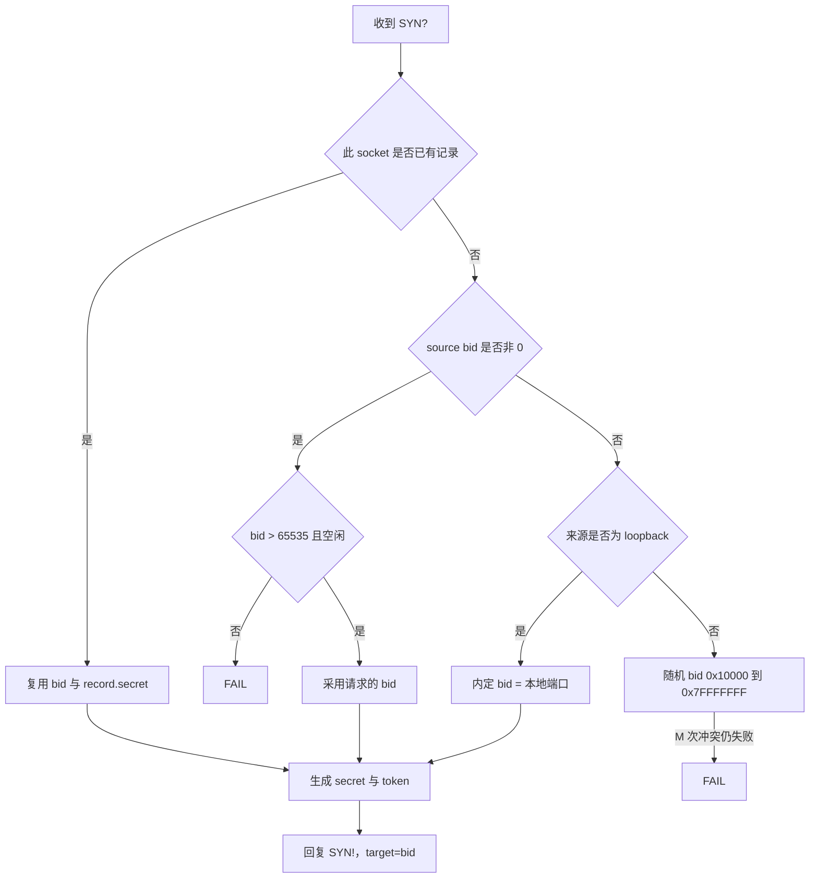
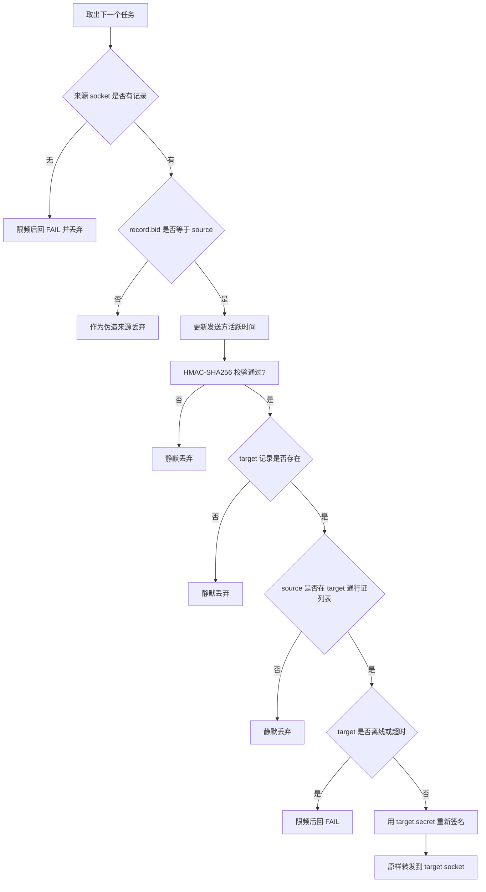

# 架构设计

N:1 的客户端-服务器拓扑。服务器是离散的中继节点，可为大量已注册客户端高效提供转发服务，与其他服务器互不关联。客户端按延迟自行选择服务器。服务器只提供最基础的转发能力。

- [线程模型](#线程模型)
- [bid record](#bid-record)
- [握手 Token](#握手-token)
- [管理线程子流程](#管理线程子流程)
- [转发线程主循环](#转发线程主循环)
- [流量控制](#流量控制)


## 线程模型

接收与转发分离，各自由独立线程处理。服务器在内存中维护一张 bid record 分配表，并建立两套索引——按 bid、按 socket 字符串 `"{ip}:{port}"`。任何时刻一个 bid 只对应一个 socket，反之亦然。


1. **接收线程**：绑定一个 UDP 端口，把 `(数据包, socket)` 直接塞进等待队列。单端口不随用户数增加 fd 占用。
2. **预处理线程**：
   - 来源为广播/多播地址 → 静默丢弃（防放大攻击）；
   - 校验协议头，失败丢弃；
   - 仅处理 B=1 的桥接包；
   - target=0 → 交给管理队列；
   - source=0 或 source==target → 上行违规丢弃；
   - 其余情况按 `n = source_bid % W` 哈希指派给第 n 条转发线程。
3. **管理线程**：负责 bid 分配、记录回收、通行证管理与系统指令应答。
4. **转发线程（W=8）**：负责数据转发。


## bid record

| 字段 | 含义 | 是否可变 |
|------|------|---------|
| `bid` | 门牌号 | 不变量 |
| `key` | socket 字符串 `"{ip}:{port}"` | 不变量 |
| `socket` | ip、port | 不变量 |
| `secret` | 客户端密钥 | 创建后不变 |
| `last_time` | 最后活跃时间 | 每个有效包更新 |
| `offline` | 主动下线标志（FIN? 设置） | 由 NOOP / 重新握手清除 |
| `allowlist` | 通行证列表，元素为 `(bid, key)` | 由 ACPT/DENY 维护 |

只有管理线程和转发线程更新 `last_time`；预处理线程不查表、不更新。


## 握手 Token

握手是**无状态**的：`SYN?` 阶段不创建任何记录。服务器用 HMAC-SHA256 生成 token"锁死"握手参数，客户端在 `ACK!` 中回传，服务器不依赖会话状态即可校验。

两种密钥，均须密码学安全随机数：

- **服务器密钥**：仅用于签发/校验握手 token，存于内存，定期轮换，永不外发。
- **客户端密钥**：服务器生成，经 `SYN!` 下发，客户端保存；此后所有签名包都用它。在 record 生命周期内固定不变。

### Token 生成规则

```
bid    = 已分配 bid（整数）
secret = record.secret（复用）或新随机值，Base64
socket = 观察到的 "{ip}:{port}"
time   = 服务器时间戳（秒）
msg    = 按 key 字典序拼接 "bid={bid}&secret={secret}&socket={socket}&time={time}"
token  = Base64( HMAC-SHA256(server_secret, msg) )
```

### Token 校验规则

```
bid    = 协议头 source bid
socket = 观察到的来源 "{ip}:{port}"
secret = 载荷中的 "secret"
time   = 载荷中的 "token_time"
用服务器密钥组（最多 2 个）逐个重算 HMAC，任一匹配即通过；全部不匹配则拒绝。
```


## 管理线程子流程

主循环先排空管理队列；空闲时按不短于 `record_recycle_interval`（默认 10 分钟）调用 `purge(now)`，回收超过 `expires` 的记录。

通用门禁：除 `SYN?` 外，所有任务要求 `source > 0`。之后：

- 按来源 socket 查记录，不存在 → 回 `FAIL`（受应答频率限制，见 [security.md](security.md)）并丢弃；
- 记录存在但 `record.bid != source` → 伪造来源，丢弃；
- 更新 `last_time`；
- 过滤未知 command；
- 按 command 分发。

### 2.1 SYN?（第一次握手，不创建记录）



本阶段不登记 socket、不保存 secret、不创建记录，转发线程因查不到记录仍不转发。

### 2.2 ACK!（第三次握手，创建记录）

- 用服务器密钥组校验 token；不匹配 → 静默丢弃。
- 检查 `token_time` 在 `handshake_token_timeout`（默认 60 秒）内，超时 → `FAIL`。
- 按 source bid 查表：
  - 不存在 → **创建 bid record**（secret 取自载荷，last_time=now）；
  - 存在且 socket 匹配 → 幂等刷新 `last_time`、清除 offline，secret 保持不变；
  - 存在但 socket 不同 → bid 竞态，回 `FAIL`，客户端重新握手。

### 其他指令

| 命令 | 处理 |
|------|------|
| `PING` | 回复 `PONG` |
| `FIN?` | 标记记录 offline，回 `FIN!`（不删记录） |
| `ACPT` / `DENY` | 校验 bid 列表；全部有效 → 改 allowlist 回 `DONE`；任一无效 → 原子回滚回 `FAIL` |
| `NOOP` | 清除 offline，**不应答**（自愈） |


## 转发线程主循环

每条转发线程为每个 source bid 维护一个等待队列，按**广度优先**轮询（每轮每个 bid 取一个），避免单个用户抢占。




## 流量控制

转发线程采用**滑动窗口**：每条线程在 `forward_window` 秒内最多处理 `forward_limit_per_window` 个任务，达上限后本轮窗口不再取新任务；队列超出 `forwarder_queue_size` 的新包直接丢弃并记日志（由客户端可靠传输重发）。

默认值：8 条线程 × 4096 包 / 0.1 秒 ≈ **327,680 包/秒**；单线程队列容量 65536（最坏约 64 MiB，约 1.6 秒突发缓冲）。
