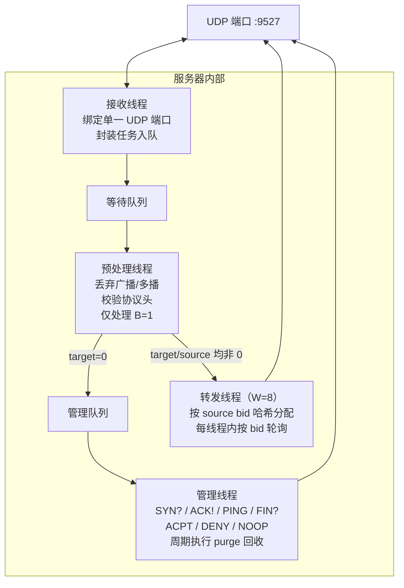
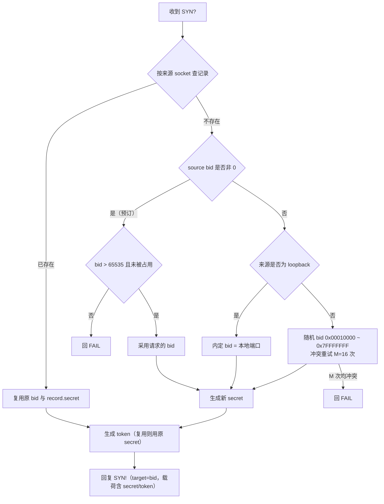
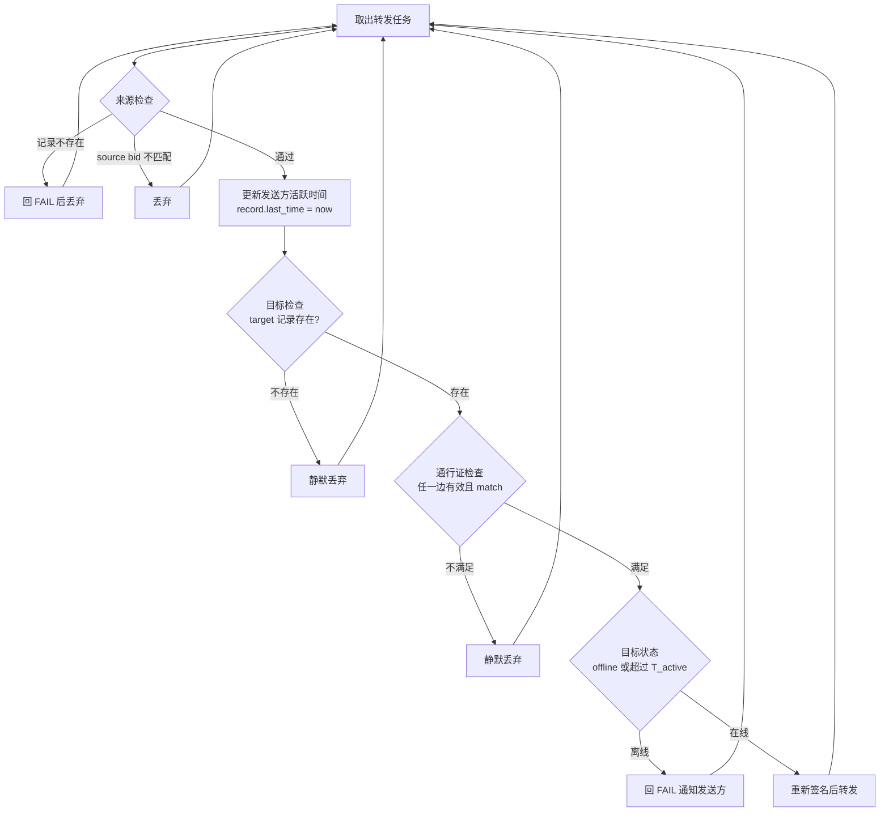

# 架构设计

N:1 的客户端-服务器拓扑。服务器是离散的中继节点，可为大量已注册客户端高效提供转发服务，与其他服务器互不关联。客户端按延迟自行选择服务器。服务器只提供最基础的转发能力。

- [线程模型](#线程模型)
- [bid record](#bid-record)
- [密钥与 Token](#密钥与-token)
- [管理线程子流程](#管理线程子流程)
- [转发线程主循环](#转发线程主循环)
- [通行证（Permit）](#通行证permit)
- [流量控制](#流量控制)


## 线程模型

接收与转发分离，各自由独立线程处理。服务器在内存中维护一张 bid record 分配表，并建立两套索引——按 bid、按 socket 字符串 `"{ip}:{port}"`。任何时刻一个 bid 只对应一个 socket，反之亦然。



1. **接收线程**：绑定一个 UDP 端口，把 `(数据包, socket)` 封装成"任务"直接塞进等待队列，不做任何判断。单端口不随用户数增加 fd 占用；
2. **预处理线程**：从等待队列取任务，丢弃广播/多播来源，校验协议头（仅处理 B=1），然后分拣——target=0 交给管理线程；target/source 均非 0 且不相等的转发包，按 `source bid % W` 哈希指派给对应转发线程；
3. **管理线程**：每个 runloop 先执行回收检查（距上次调用超过 `record_recycle_interval` 默认 10 分钟则调用 purge），再从管理队列取任务，负责握手、系统指令应答、通行证管理与记录回收；
4. **转发线程（W 条）**：内部为每个 source bid 维护一个等待转发队列，广度优先轮询处理转发任务。

> 转发任务的分配：`n = (source bid) % W`，指派给第 n 条转发线程；单条线程只负责与其编号对应的转发任务。


## bid record

Record 属性：

| 属性 | 说明 |
|------|------|
| `bid` | 门牌号（不变量） |
| `key` | 客户端索引 `"{ip}:{port}"`（不变量） |
| `socket` | 客户端信息 ip、port；类型 SocketAddress（不变量） |
| `secret` | 客户端密钥（不变量） |
| `last_time` | 最后活跃时间 |
| `offline` | 主动下线标志（"FIN?" 置位；仅 "ACK!" 幂等分支或 "NOOP" 清除） |
| `allowlist` | 通行证列表，建议 `Map<int, Permit>`，上限 `allowlist_max_entries`（默认 1000） |

注：

1. bid/key/socket/secret 均为**不变量**，记录一经创建永不改变——socket 与记录绑定后不可迁移至其他 socket，来源 socket 不匹配一律按冲突/伪造处理；
2. 每次收到有效数据包都要更新 `last_time`；更新须在校验全部通过之后进行（见安全扩展文档）；
3. `offline` 由 "FIN?" 置位，仅 "ACK!"（重新握手）或 "NOOP" 清除；"PING" 及数据转发只更新 `last_time`，不改变 `offline`；
4. `allowlist` 条目上限为 `allowlist_max_entries`（默认 1000），由 "ACPT"/"DENY" 指令维护，随记录回收（purge）自动删除。


## 密钥与 Token

| 密钥 | 说明 |
|------|------|
| 服务器密钥 | 仅用于生成/校验 Token，只保管在服务器上（内存列表，10 分钟轮换一次）；永不外发 |
| 客户端密钥 secret | 服务器生成、经握手发给客户端；握手成功后所有系统指令均用其签名/验签；生命周期内永不改变 |

Token 生成规则（服务器在 "SYN?" 时计算，随 "SYN!" 下发）：

1. 取 bid（新建/内定/预订/复用，十进制正整数）；
2. 取 secret（复用流程取原 record.secret，否则随机生成后 Base64 编码）；
3. 观察得到客户端 socket（`"{ip}:{port}"` 字符串）；
4. 取服务器当前时间戳 time（秒）；
5. 按 key 字典序排序合并 `bid={bid}&secret={secret}&socket={socket}&time={time}`；
6. 取最新服务器密钥对该字符串计算 HMAC-SHA256，结果 Base64 编码。

Token 校验规则（服务器在 "ACK!" 时重算比对）：取协议头 source bid、观察到的来源 socket、载荷中的 `secret` 与 `token_time`，同样排序合并后，用全部服务器密钥（最多 2 个）逐个重算并与载荷中的 `token` 比对——任一匹配即成功；全部不匹配判定为不可信来源。


## 管理线程子流程

管理线程取任务后，除 "SYN?"（唯一允许 source bid 为 0 的场景）与 "ACK!" 外必须 source > 0；随后做**来源检查**（按来源 socket 查记录：不存在则按连接未确认处理——回复 "FAIL" 后丢弃；存在则校验 source bid 是否匹配，不匹配按伪造来源丢弃），再检查 command 是否属于已支持的系统指令，全部通过后按 command 走子流程。

### SYN? 分配决策（无状态，不创建记录）



| 指令 | 处理 |
|------|------|
| "SYN?" | 第一次握手（无状态，不创建记录）：先按 socket 查记录，存在则**复用**原 bid 与 secret；否则按 source bid 走**预订流程**（非 0，须 > 65535，查表冲突则回 "FAIL"）；source=0 且来源为 loopback 走**内定流程**（bid = port）；否则**正常分配**；拿到 bid 后生成 secret 与 token，经 "SYN!" 下发 |
| "ACK!" | 第三次握手（无状态令牌验证）：用服务器密钥组校验 token；匹配后检查 `token_time` 是否超出有效窗口（`handshake_token_timeout` 默认 60 秒，超时回 "FAIL"）；通过后按 source bid 查表——不存在则创建记录（secret 取自载荷，连接确认）；存在且 socket 匹配则幂等更新（刷新 last_time、清除 offline、secret 不变）；存在但 socket 不同则回 "FAIL" |
| "PING" | 按协议回复 "PONG" |
| "FIN?" | 标记记录 offline，回复 "FIN!"；不删除记录、不释放 bid（仍按超时规则回收） |
| "ACPT"/"DENY" | 解析载荷取出 bid 列表；"ACPT" 逐个检查有效性（记录存在且不含自身 bid，任一无效整体拒绝回 "FAIL"），全部有效则按通行证**添加流程**执行（含上限检查，超限整体拒绝），完成后回 "DONE"（含 `src-command` 并回显原 bid 列表）；"DENY" 按**删除流程**执行（含清空标记判定，幂等），完成后回 "DONE" |
| "NOOP" | 清除 offline 标记，不应答（用于意外 "FIN!" 后的秒级自愈） |

> 校验策略：socket、source bid、载荷等已在上一步取任务过程中校验过，子流程内无需重复校验；已绑定客户端的应答不限频（见安全扩展文档）。


## 转发线程主循环

广度优先轮询辖下 source bid 的等待转发队列（均无任务时 sleep 后继续），对取出的任务依次执行：



1. **来源检查**：按来源 socket 查记录——不存在则按连接未确认回 "FAIL" 后丢弃；存在则校验 source bid 是否匹配，不匹配按伪造来源丢弃；
2. **更新活跃时间**：来源检查通过后更新发送方记录的 `last_time = now`（附加校验码验证在此前后完成，见安全扩展文档）；
3. **目标检查**：查 target bid 记录，不存在则静默丢弃（记录回收时间长，正常不会遇到，多为伪造包）；
4. **通行证检查**：先在发送方记录的 allowlist 中查 target 的通行证，若不存在再在 target 记录的 allowlist 中查发送方的通行证；命中后校验来源 socket 与通行证匹配（Permit.match）并判定有效（Permit.valid）；任一边查到有效且来源匹配即放行（防止一方被攻击者强行删除通行证），均不满足则静默丢弃（不应答、不转发，防止暴露收件人存在与接纳状态）；
5. **目标状态**：target 记录 `offline == true` 或 `last_time` 超过 `T_active`（在线判定窗口，默认 60 秒）时，发送方已被接纳，可回 "FAIL" 通知；否则进入完整转发；
6. **完整转发**：以上全部通过后，将数据包转发给 target 对应的 socket（附加校验码按接收方密钥重新签名，见安全扩展文档）。

> 转发线程不做超时覆盖判断——过期记录的回收仅由管理线程通过 purge 完成。


## 通行证（Permit）

通行证是双方的"发送许可"，为**双向同意关系**（Permit 为双向共享对象）：任一方添加、双方确认后生效，服务器才转发；单方 "DENY" 仅在发起方记录中删除映射，对方记录中的有效通行证仍在，通信不受影响；彻底解除需双方均 "DENY"；单方拒收（拉黑）由应用层处理。

### 添加流程（A "ACPT" B）

先在 A 的记录中查 B 的通行证；不存在则到 B 的记录中查 A 的通行证；仍不存在则新建一个属于 B 的通行证并填入 B 的信息，否则绑定 B 的信息；最后放入 A 的记录：

```dart
var permit = X.record.allowlist[Y];
if (permit == null) {
    permit = Y.record.allowlist[X];
    if (permit == null) {
        permit = Permit(Y.record);       // 新建，填入 B 的 socket
    } else {
        permit.accept(Y.record);         // 已存在，绑定 B 的信息
    }
    X.record.allowlist[Y] = permit;
}
```

同一 Permit 对象被双方记录共享引用；重复 "ACPT" 幂等，不会产生重复条目。

### 删除流程（A "DENY" B）

先判断载荷是否为清空标记（见下），命中则清空；否则校验 bid 合法性（须在 0 ~ 4294967295 内、非负数、非 0、不等于发送方自身 bid），然后从 A 的记录中删除映射：

```dart
X.record.allowlist.remove(Y);
```

B 的记录不存在也当作删除成功（幂等）。一方记录被回收后（Permit 随之消失），服务器取不到目标记录即不再转发，关系自然失效。

### 清空通行证

出于状态重置的目的（应用重启丢失列表、或列表被恶意填充打满时无法得知现有条目），设计了一个特殊的 "DENY" 指令：

```json
{
    "sources": [-1, -2, -3],
    "time": 1234567890
}
```

服务器收到 "DENY" 时，若 sources 长度刚好为 3 且依次为 -1、-2、-3（**严格按序**，客户端必须按此顺序编码），则执行 `allowlist.clear()`；清空前先取出 `sources = allowlist.keys.toList()`，在 "DONE" 应答中回显被清空的 bid 列表。

> 选用三个有序负值是为防止客户端误操作：单个负值（如 -1）常作为哨兵/错误码，空列表更易因未填充误触发；实现时不得简化为单值或乱序匹配。

### 通行权检查

服务器检查 A 是否有权给 B 发消息时，先后在双方记录的 allowlist 中查找，任何一边查到有效通行证均放行；命中后还需校验来源 socket 与通行证匹配（防 bid 回收重分配后误放行）：

```dart
permit = X.record.allowlist[Y];
permit ??= Y.record.allowlist[X];
ok = permit != null && permit.valid && permit.match(X.record);
```

### Permit 定义

```dart
class Permit {
    Permit(Record record) : _s = record.socket;

    final SocketAddress _s;
    SocketAddress? _t;

    bool get valid => _t != null;                 // 双方确认后生效

    bool match(Record record) => _s == record.socket || _t == record.socket;

    bool accept(Record record) {
        if (_s == record.socket) {
            return true;
        } else if (_t == null) {
            _t = record.socket;
            return true;
        }
        return _t == record.socket;
    }
}
```

通行证的第二个 socket 信息只有赋值、没有清空操作，所以只要双方确认过即生效，直到双方都删除为止。SocketAddress 为抽象类型（解析 `"127.0.0.1:8080"`、`"[::1]:8080"`，IPv6 序列化时用 `[]` 包裹），定义见用户信息记录文档附 2。


## 流量控制

为避免流量风暴，转发线程采用**滑动窗口**限流：每条线程在 `forward_window` 秒内最多处理 `forward_limit_per_window` 个任务，达到上限后本轮窗口不再取新任务；超过队列容量（`forwarder_queue_size`）的新任务直接丢弃并记录日志（由客户端可靠传输机制重试）。

系统将转发任务拆分给 W=8 条线程处理，单条线程达到上限不会影响其他线程，将风暴控制在小影响范围内。相关参数及默认值见服务器实现文档。
