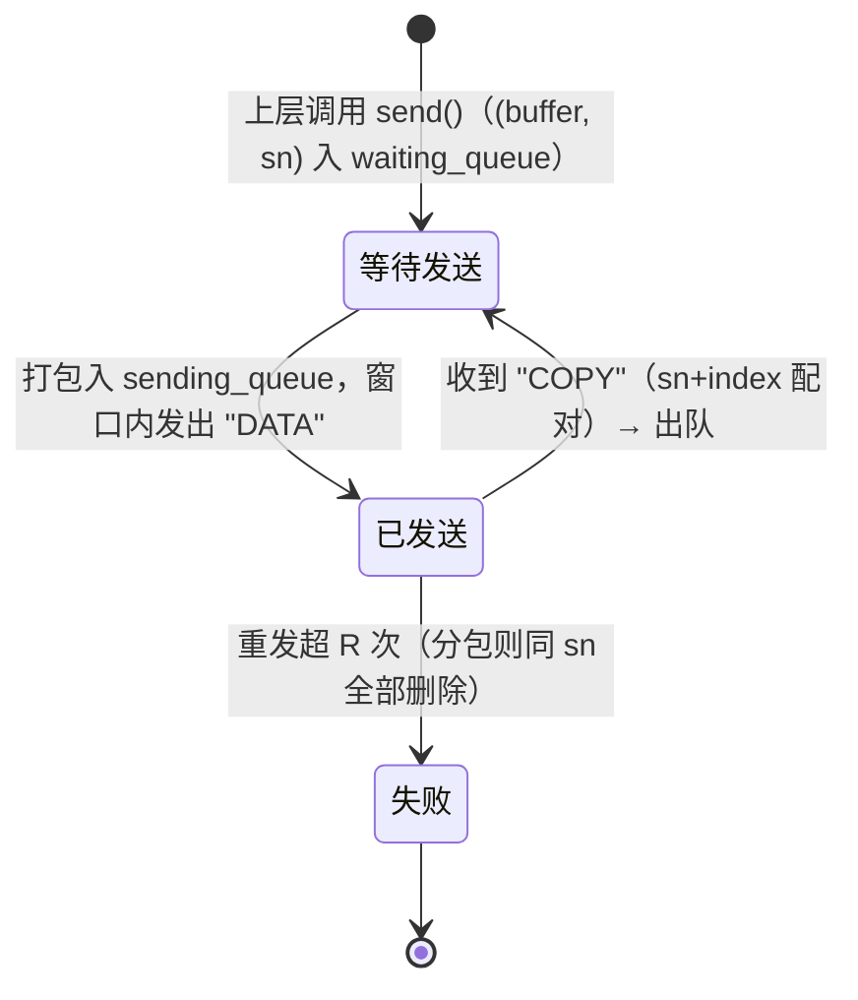
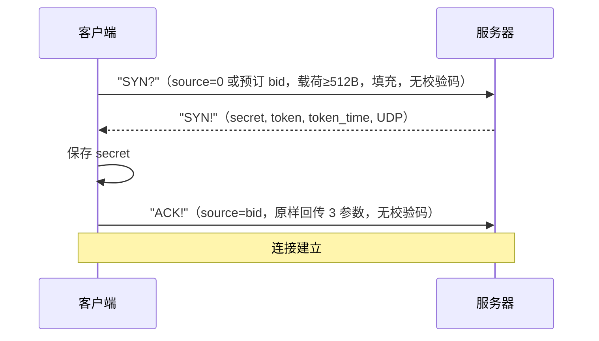
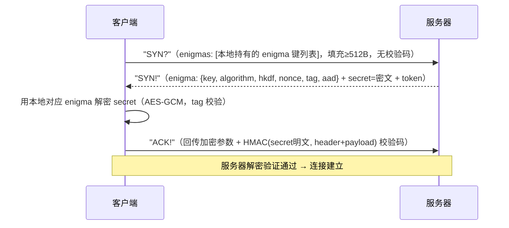
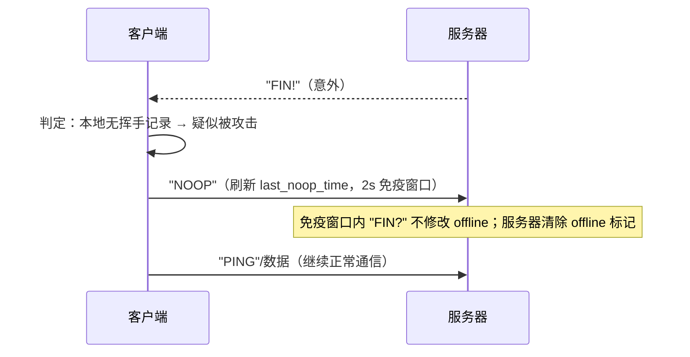

# Magpie Bridge 客户端实现

客户端参考行为说明。客户端是**管道（连接）管理**的主体：每个对端（无论直连还是经服务器中转）对应一条管道，管道维护发送队列、接收队列与心跳状态。本文档合并定义客户端全部行为：mid 标识、收发流程、握手（含加密）、心跳与自愈、断线处理与测试流程。

---

## 1. 管道与连接

```
+--------------------------------------------------------------+
|                           客户端                              |
|  +--------------------------------------------------------+  |
|  |                      管道管理器                          |  |
|  |   +-----------+   +-----------+   +-----------+        |  |
|  |   | 管道 A    |   | 管道 B     |   | 管道 C     | ...    |  |
|  |   | 发送队列   |   | 发送队列   |   | 发送队列    |        |  |
|  |   | 接收队列   |   | 接收队列   |   | 接收队列    |        |  |
|  |   | 心跳状态   |   | 心跳状态   |   | 心跳状态    |        |  |
|  |   +-----+-----+   +-----+-----+   +-----+-----+        |  |
|  +-----------+-----------+-----------+--------------------+  |
|              |           |           |                       |
|              v           v           v                       |
|          +------------------------------------------------+  |
|          |            网络层（UDP 收发 + 打包解包）           |  |
|          +------------------------------------------------+  |
+--------------------------------------------------------------+
```

- 客户端 A 到客户端 B 的**直连管道**（B=0）与**桥接管道**（B=1，经服务器转发）是两条独立管道；
- 每条管道独立握手、独立维护队列与心跳；
- 数据包唯一标识 **mid** 用于收发配对与去重（计算方式见下节）。

---

## 2. 数据包唯一标识（mid）

客户端在接收数据包时，需要对 (sn, index) 去重（同一数据包可能因网络重传或应答重发多次到达）。mid 由客户端自行计算，这里仅作建议：

```
mid = (sn << 32) | index
```

- sn 固定占用高 32 位、index 固定占用低 32 位，互不重叠、与分包参数宽度 E 无关，天然无碰撞；E=0 时无 index，可令 index=0（此时 mid = sn << 32）；
- 发送方用 mid 在发送队列中配对 "COPY" 应答（收到即出队）；
- 接收方用 mid 去重（重复子包忽略）并拼接分包；
- 去重仅针对普通数据包（A=0, D=1）进行；系统指令（D=0）不参与；应答包（A=1）无需去重（重复应答在发送队列中找不到匹配任务时自然失效）。

> 只要遇到 D=1 且 A=0 的数据包，不管 mid 是否重复，都必须回复 "COPY" 应答。

---

## 3. 发送流程

### 3.1 发送队列

发送队列与"有向管道"绑定（管道包含 socket 信息、target bid 与 source bid，以下各步无需再指明 bid）。

每条管道维护一个**等待队列** waiting_queue（存放原始数据 buffer + sn）与一个**发送队列** sending_queue（存放发送任务：打包/分包后的数据包、发送时间、发送次数）：

| 参数 | 默认值 | 建议区间 | 说明 |
|------|--------|----------|------|
| 重发超时 T | 2 秒 | 1~5 秒（自适应） | 距上次发送超过 T 的任务重发 |
| 重发上限 R | 3 次 | 2~5 | 超过则删除任务（实时音视频可减至 2，消息/文件可增至 4~5；可选指数退避 T、2T、4T） |
| 发送窗口 K | 16 | 8~64 | 队列前 K 个为"发送中"在途任务（收到应答即移出），K 即在途上限 |
| 队列容量 C | 128 | 64~512（一般为 K 的 4~16 倍） | 含在途与排队任务；满则暂停从等待队列取数据 |

> 系统指令（D=0）与应答包（A=1）直接发送、不入队；"COPY" 应答本身不重发（若丢失由对端超时重发保障，接收方对重复包仍回 "COPY"，最终收敛）。



### 3.2 发送主循环

发送线程每轮循环：

1. 检查发送队列前 K 个任务的发送状态：未发送过 → 首次发送（记录发送时间）；距上次发送超 T → 重发；重发次数超 R → 删除任务（分包则删除同 sn 全部任务），按"发送结果回调"处理；
2. 等待队列为空 → sleep 后回到步骤 1；
3. 发送队列已满（任务数 ≥ C）→ sleep 后回到步骤 1；
4. 从等待队列取出一份数据（移除该 (buffer, sn)）打包，超过载荷上限（1024）则分包（E 自动升档、共享 sn、index 递增），按 index 顺序创建发送任务放入队尾（此批分包入队后队列长度可能超过 C，允许，等低于 C 再触发下一轮取数据）。

### 3.3 发送结果回调

- **整包成功**：某 sn 的所有发送任务（含分包）都被 "COPY" 应答删除时回调成功（携带 sn）；
- **整包失败**：某任务重发超 R 被删除时（分包则同 sn 全部删除）回调失败（携带 sn）；
- 回调仅通知上层；原始数据在打包时已从等待队列移除，上层如需重试需自行保留数据。

---

## 4. 接收流程

### 4.1 接收队列

接收队列同样与"有向管道"绑定。客户端维护一个**接收表单** receiving_table（以 sn 为 key，value 为"分包列表 + 最后更新时间"）与一个**接收成功集** received_sn_set（已接收成功的数据包 sn）。

收到数据包先入接收队列，由接收循环统一处理：

1. 解析包 → 按来源（直连 socket / 桥接 source bid）找到对应管道，无管道则新建并分配接收队列；
2. **命令类（D=0）**：直接交给相应处理器——"SYN!" → 完成握手、"PONG" → 心跳确认、"FIN!" → 挥手/自愈判断、"FAIL"/"DONE" → 通知等待方；
3. **数据类（D=1）**：转交给接收逻辑（普通数据应答包 A=1, D=1 则转交发送队列处理）。

### 4.2 数据接收逻辑

- **Mini 包（A=0, D=1, E=0）**：先回 "COPY" → 查 received_sn_set，sn 已存在则丢弃；否则标记并回调 payload；
- **分包包（A=0, D=1, E>0）**：先回 "COPY" → sn 已收完整则丢弃；否则按 index 存入 receiving_table 对应列表（同 index 重复覆盖），填满后并包回调、从 receiving_table 删除该 sn 并标记 received_sn_set；
- **接收表清理**：receiving_table 中未收满的列表驻留超过 T2（接收超时，默认 30 秒）删除（可选回调"接收失败"）；received_sn_set 仅保留最近 N 个 sn（如 1024），防止无限增长。

### 4.3 失败应答 "FAIL"

客户端收到 "FAIL"（D=0）时，结合自身状态与载荷字段识别场景：

- 等待 "SYN!" 时收到（载荷仅含 time）：bid 分配失败，重新申请或放弃；
- 载荷含 src-command 时再区分：
  - src-target 存在 → 对端离线，通知上层即可，无需重试；
  - sources 存在（无 src-target）→ 无法修改通行证，剔除失败子集重试或放弃；
  - 两者皆无（仅 src-command 与 time）→ 连接未确认，直接补发 "ACK!"（幂等，token 未过期）。

> 无附加校验码的 "FAIL"（bid 分配失败、连接未确认——记录未创建时服务器无 secret 可计算校验码）可被攻击者伪造，只能诱导补发 "ACK!" 或重新握手，客户端处理须幂等、无副作用。

### 4.4 接收管道分拣

| 包来源 | 识别 | 处理管道 |
|--------|------|----------|
| 直连包 | B=0 | 按来源 socket 匹配管道 |
| 桥接转发包 | B=1, target=自己 | 按 source bid 匹配管道 |
| 服务器应答 | B=1, source=0 | 按 target（自己 bid）匹配管道 |

---

## 5. 握手

### 5.1 基础握手



客户端注意：

- "SYN?" 载荷需填充至 ≥ 512 字节（`handshake_min_payload`），否则服务器丢弃；
- 首次握手 source=0；重连可复用原 bid（服务器按来源 socket 查记录复用，无需特意携带旧 bid）；
- 记录服务器返回的 "UDP" 地址（供直连探测用）。

### 5.2 加密握手

服务器启用应用密钥（配置了 `app_secret_file`）时：



- 客户端把 "SYN!" 载荷中的 "enigma" 参数原样回传（"ACK!" 载荷 = "SYN!" 的 3 个握手参数 + enigma + 填充）；
- 解密失败（tag 校验不过）说明密钥不匹配或握手被篡改，放弃本次握手；
- 加密模式 "ACK!" **必须带** 32 字节校验码（用解密后的 secret 明文计算）。

---

## 6. 心跳与保活

心跳为**空闲触发**（非定期发送）：距最后一次**收/发**数据（含应答包）超过 H（空闲阈值，默认 10 秒）时才发送 "PING"；10 秒内只要有任一方向流量，就不发心跳。保活作用依赖上行 "PING" 本身——只要任一方向有流量，NAT 映射计时器即被重置，因此 "PONG" 丢失不影响保活，也不重发。

- 对端收到 "PING" 回复 "PONG"（D=0 直接发送、不入队）；**实现建议**：回复时回显收到的载荷除 "time" 外字段（"time" 更新为本机时间，见协议文档"心跳"），发送方可用回显内容做 RTT 测量/应答匹配；
- "NOOP" 与 "PING" 同样刷新服务器端 last_time；"NOOP" 额外刷新 last_noop_time（防踢人免疫窗口，见 7 节）；
- **断线判定**：以"距最后一次**收到**对端数据包（PONG/COPY/数据/系统指令均可）超过 D 秒"为准（默认 D = 6×H = 60 秒；发数据不刷新该计时）——与服务器活跃超时（60 秒）同步，便于客户端主动重连；
- 心跳包载荷只需 `{"time": ...}`，与服务器通信须带校验码；
- 局域网/可信内网（无 NAT）可把 H 调大至 60 秒。

---

## 7. 自愈（意外 "FIN!"）

正常客户端若收到**未主动请求过的 "FIN!"**，说明可能被攻击者冒充踢线：



- 攻击者在免疫窗口内无法再踢线；
- 自愈仅需发送 "NOOP"（恢复在线），无需重新握手或修改通行证；
- 注意：记录创建后从未发送过 "NOOP" 时，`last_noop_time` 视为已超出免疫窗口（等价于未设置即过期，见服务器工作流文档），此时收到的 "FIN?" 会被标记离线。

---

## 8. 断线处理

| 场景 | 客户端行为 |
|------|-----------|
| 主动断开 | 发送 "FIN?" → 等 "FIN!" → 关闭管道（超时兜底） |
| 心跳超时 | 清理管道 → 重新握手（复用原 bid 或申请新 bid） |
| 服务器不可达 | 切换到其他服务器（客户端按连通速度自选） |
| 意外 "FIN!" | 自愈流程（见第 7 节），不主动断开 |

---

## 9. 桥接通信测试流程

验证两个客户端经服务器转发通信：

1. 客户端 A、B 分别与服务器握手，获得 bid X、Y；
2. A 发送 "ACPT" [Y]，B 发送 "ACPT" [X]（双向通行证生效）；
3. A 向 Y 发送 "DATA"（sn=1）；
4. 服务器转发给 B，B 回 "COPY"；
5. A 收到 "COPY"，发送队列出队，通信成功；
6. 观察服务器统计日志（received/dispatched/forwarded 等）确认流转。

---

## 10. 工程目录

- **Java 版客户端**：`magpie/tests-java/`；
- **Dart 版客户端**：`magpie/tests-dart/`（Flutter 样板工程）。
