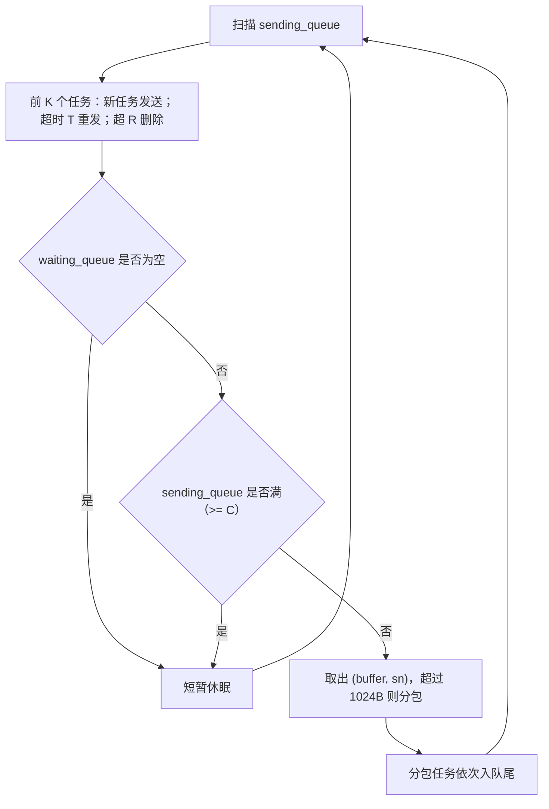
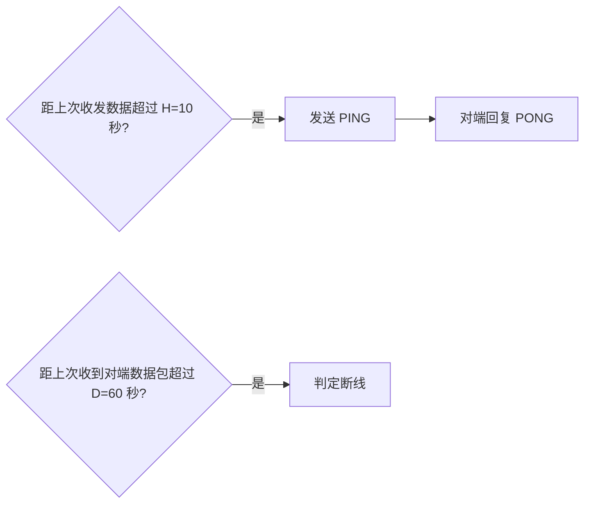

# 客户端实现

客户端参考行为说明。

- [数据包唯一标识 mid](#数据包唯一标识-mid)
- [发送队列](#发送队列)
- [发送主循环](#发送主循环)
- [接收侧](#接收侧)
- [FAIL 处理](#fail-处理)
- [心跳与自愈](#心跳与自愈)
- [测试流程](#测试流程)


## 数据包唯一标识 mid

收到的普通数据包（A=0, D=1）可能因网络重传或应答重发多次到达，需按 `(sn, index)` 去重。建议：

```
mid = (sn << 32) | index
```

sn 固定占高 32 位、index 占低 32 位，两者互不重叠，与分包宽度 E 无关。E=0 时无 index，可令 index=0（此时 mid = sn << 32）。客户端也可采用任何能唯一标识数据包的方案。

- 去重仅针对普通数据包（A=0, D=1）；系统指令（D=0）不参与。
- 应答包（A=1）无需去重——重复应答在发送队列中找不到匹配任务时自然失效。
- **只要遇到 (A=0, D=1) 的包，无论 mid 是否重复，都必须回 `COPY`。**


## 发送队列

每条有向管道（管道绑定 socket 信息、target bid、source bid）维护两个队列：

- `waiting_queue`：原始 buffer 与其自增 sn。
- `sending_queue`：发送任务（打包/分包后的数据包、发送时间、重发次数）。

系统指令（D=0）与应答包（A=1）直接发送，不入队。`COPY` 本身不重发——若丢失由对端超时重发，接收方对重复包仍回 `COPY`，最终必然收敛。

| 参数 | 含义 | 默认 | 建议区间 |
|------|------|------|----------|
| T | 重发超时 | 2 秒 | 自适应 1~5 秒 |
| R | 最大重发次数 | 3 | 2~5 |
| K | 发送窗口（在途上限） | 16 | 8~64 |
| C | 发送队列容量 | 128 | 64~512（4~16 倍 K） |


## 发送主循环



说明：

- 前 K 个任务即为"在途未确认"集合——任务收到 `COPY` 后即从队列移除。
- 若某任务重发超过 R 仍无应答，删除；若是分包，把同一 sn 的所有任务一并删除。
- 分包批次入队后可能暂时使队列长度超过 C，下一轮"取数据入队"要等到队列长度回落至 C 以下才触发。
- 收到应答（A=1, D=1）：按 sn + index 找到对应任务并移除。
- 回调：某 sn 的全部分包都被应答删除 → "发送成功"（携带 sn）；某任务重发超 R 被删除 → "发送失败"（携带 sn）。原始数据在出队时已从 waiting_queue 移除，上层如需自行重试需保留副本。


## 接收侧

- `receiving_table`：key = sn，value = 分包列表 + 最后更新时间。
- `received_sn_set`：已成功组装的 sn 集合（环形保留最近 N 个，如 1024）。

### 微型包（E=0）

1. 取 sn，回 `COPY`；
2. 若 sn 已在 `received_sn_set`，直接返回；
3. 将 sn 加入集合；
4. 把 payload 与 sn 一起回调。

### 分包（E>0）

1. 取 sn、index、count，回 `COPY`；
2. 若 sn 已在 `received_sn_set`，直接返回；
3. 按 sn 在 `receiving_table` 中查找，不存在则创建长度为 count 的空列表；
4. 将数据包放入列表的 index 位置（同 index 重复到达直接覆盖——内容相同，覆盖与跳过等价；填满判定基于位置非空，与到达次数无关），更新该 sn 的最后更新时间，列表未填满则返回；
5. 列表填满即收齐，先在 `received_sn_set` 中标记；
6. 对整列表执行"并包"，把原始数据与 sn 一起回调；
7. 并包完成后删除 `receiving_table` 中该 sn 的列表（`received_sn_set` 已标记，后续重复包在第 2 步直接返回，不再组装）。

### 清理

`receiving_table` 中未填满的列表驻留超过 T2（接收超时，默认 30 秒，须大于发送方最坏重发窗口 R×T 并留链路余量）即视为接收失败，直接删除该 sn 的列表（可选回调"接收失败"）。检查时机可在处理新包时顺带扫描，或空闲时统一清理。


## FAIL 处理

客户端结合自身上下文与载荷字段识别 `FAIL` 场景：

| 上下文 | 载荷 | 含义 | 动作 |
|--------|------|------|------|
| 等待 `SYN!` 时 | 仅 `{time}`（无 src-command） | bid 分配失败 | 重新申请或放弃 |
| 发送 ACPT/DENY 后 | `{sources:[...], time}`（无 src-command） | 通行证修改失败 | 按失败子集重试或放弃 |
| 有 src-command，无 src-target | | 连接未确认 | 补发 `ACK!`（幂等，token 有效） |
| 有 src-command + src-target | | 对端离线（src-target 即收件人 bid） | 通知上层；不重试 |

> 无附加校验码的 `FAIL`（bid 分配失败、连接未确认——记录尚未创建，服务器无 secret 可算校验码）可被伪造，最多诱导客户端补发 `ACK!` 或重新握手，处理必须幂等、无副作用。


## 心跳与自愈

心跳用于维持 UDP NAT 映射、告知服务器客户端在线（服务器 `T_active`=60 秒）、探测对端活性。



- **空闲触发，而非定期发送**：距上次收/发（含应答包）超过 H（默认 10 秒）才发 `PING`；10 秒内任何流量都重置计时。
- `PONG` 丢失不影响保活——上行 `PING` 本身即刷新 NAT 映射计时器，`PONG` 不重发。
- **断线判定**以"距上次收到对端数据包（PONG/COPY/数据/系统指令均可）超过 D 秒"为准（默认 D = 6×H = 60 秒），与本端发数据无关。
- **意外 `FIN!` 自愈**：客户端未主动发过 `FIN?` 却收到 `FIN!`，立即回 `NOOP`（不应答；桥接时 B=1、直连时 B=0），服务器清除 offline 标志，一秒内恢复在线，无需重新握手。
- 判定断线后：通知上层（对端离线），清理该有向管道在 waiting_queue / sending_queue / receiving_table 中的残留；随后可自动重新握手。重握手无需特意携带旧 bid——服务器优先按 socket 查分配表，记录未被回收（默认 24 小时）则直接复用原 bid。


## 测试流程

两个客户端 A（被动）和 B（主动）。

### A（被动模式）

1. 绑定 UDP，向服务器申请 bid；收到 `FAIL` 则重试。
2. 展示分配到的 bid 与服务器返回的 socket 信息。
3. 通过其他渠道获知发送方 bid，发 `ACPT` 接纳对方（收到 `FAIL` 时按载荷中的失败 bid 子集处理）。
4. 等待其他客户端发数据。
5. 等待期间维护心跳。
6. 收到数据后按协议自动回复 `COPY`。
7. 展示收到的内容与发送方信息（bid 或 socket）。

### B（主动模式）

1. 绑定 UDP，向服务器申请 bid；收到 `FAIL` 则重试或放弃。
2. 展示分配到的 bid 与服务器 socket 信息。
3. 等待用户输入接收方信息（bid 或 socket）。
4. 等待用户输入接收方 bid 与要发送的文本。
5. 构造 `BridgePacket` 交服务器转发（服务器仅转发已被收件人通过 `ACPT` 接纳的包；本测试中 A 须先接纳 B，否则 B 的包被静默丢弃、收不到 `COPY`）。
6. 等待对端 `COPY` 应答，将消息状态更新为"已接收"。
