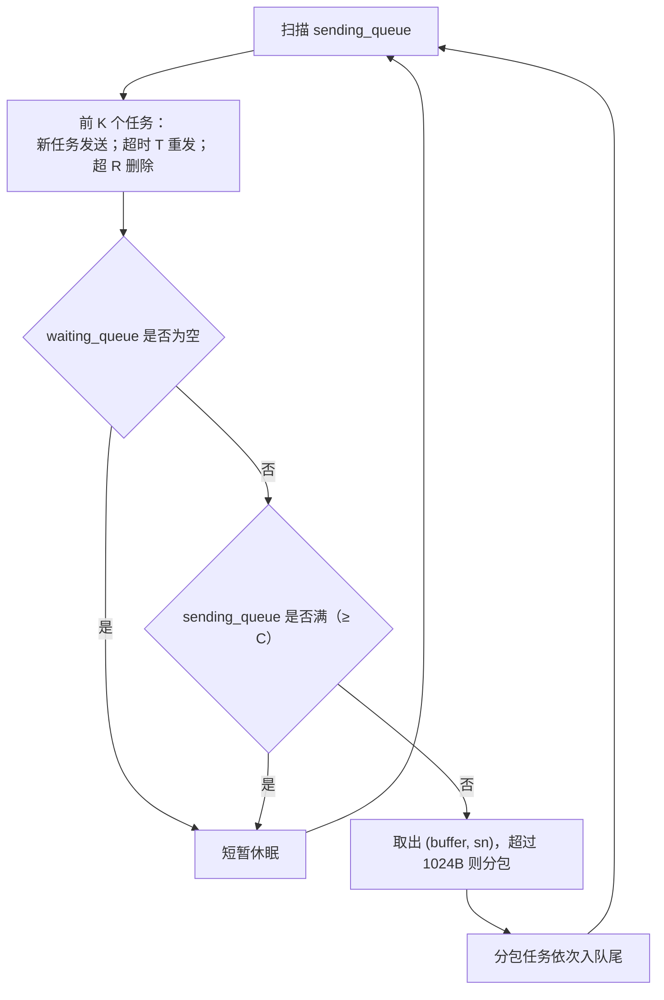
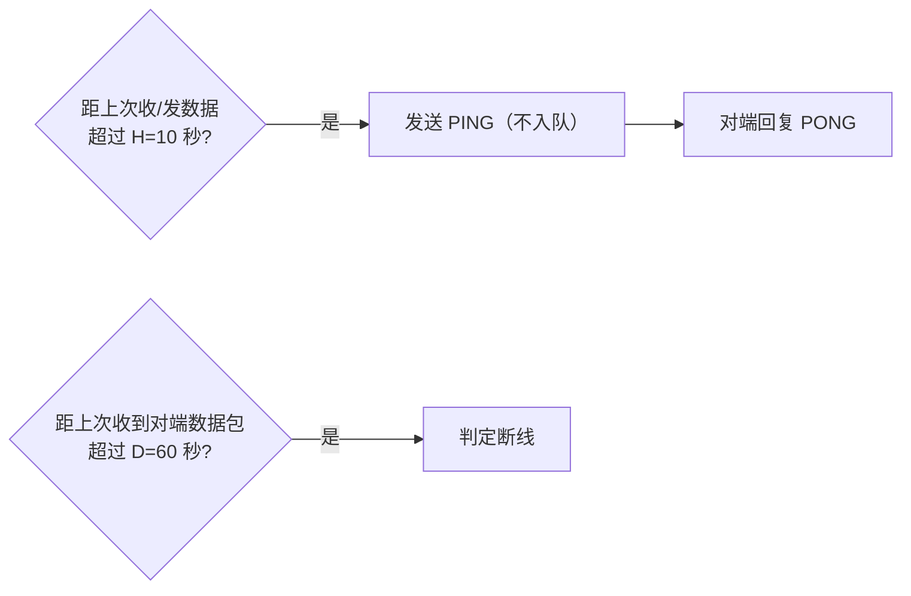

# 客户端实现

客户端参考行为说明。

- [数据包唯一标识 mid](#数据包唯一标识-mid)
- [发送队列](#发送队列)
- [发送主循环](#发送主循环)
- [接收侧](#接收侧)
- [心跳与自愈](#心跳与自愈)
- [测试流程](#测试流程)


## 数据包唯一标识 mid

收到的普通数据包（A=0, D=1）可能因网络重传或应答重发多次到达，需按 `(sn, index)` 去重。建议：

```
mid = (sn << 32) | index
```

sn 固定占高 32 位、index 占低 32 位，两者互不重叠，与分包宽度 E 无关。E=0 时无 index，可令 index=0（此时 mid = sn << 32）。客户端也可采用任何能唯一标识数据包的方案。

- 去重仅针对普通数据包（A=0, D=1）；系统指令（D=0）不参与；
- 应答包（A=1）无需去重——重复应答在发送队列中找不到匹配任务时自然失效；
- **只要遇到 (A=0, D=1) 的包，无论 mid 是否重复，都必须回 "COPY"。**


## 发送队列

每条有向管道（管道绑定 socket 信息、target bid、source bid）维护两个队列：

- `waiting_queue`：原始数据 buffer 与其自增 sn；
- `sending_queue`：发送任务（打包/分包后的数据包、发送时间、重发次数）。

> 系统指令（D=0）或应答包（A=1）直接发送即可、无需入队。应答包（"COPY"）本身不重发；若丢失由对端超时重发保障，接收方对重复包仍回 "COPY"，最终必然收敛。

参数说明：

| 参数 | 默认 | 建议 | 说明 |
|------|------|------|------|
| T（重发超时） | 2 s | 1~5 s 自适应 | 距上次发送超过 T 的任务重发 |
| R（重发上限） | 3 | 2~5 | 实时音视频可减至 2 快速失败，消息/文件可增至 4~5；可选指数退避 T、2T、4T |
| K（发送窗口） | 16 | 8~64 | 在途任务上限；K 越大单连接可靠吞吐越高（≈ K×包大小/RTT），但超时重传突发也增大 |
| C（队列容量） | 128 | 64~512（K 的 4~16 倍） | 队列总容量上限（含在途与排队），达到即暂停从等待队列取数（C=128 时最坏约 128 KiB） |


## 发送主循环



发送线程每次循环：

1. 检查 `sending_queue` 前 K 个（在途）任务的发送状态：未发送过的首次发送（记录发送时间）；已发送且距上次超过 T 的重发；重发次数超过 R 的删除（按发送结果回调处理）；
   > 队列前 K 个即"发送中"（在途未确认）任务——收到应答即移出队列，因此前 K 个必然是未确认的；第 K+1~C 个处于排队状态，窗口内任务收到应答腾出空间后依次前移。
2. 检查 `waiting_queue` 是否为空，是则 sleep 后回到步骤 1；
3. 有数据则检查 `sending_queue` 是否已满（任务数 ≥ C），已满则 sleep 后回到步骤 1；
4. 从 `waiting_queue` 取出一份数据打包，创建发送任务放入队尾，回到步骤 1。

注意：

- 步骤 1 中重发次数超过 R 时，若该任务是分包，直接把队列中所有相同 sn 的任务全部删除；
- 步骤 4 中数据超过载荷上限（1024）需分包，为每个分包创建任务按 index 顺序放入队尾；入队后队列长度可能超过 C，这是允许的——等队列再次低于 C 才触发下一轮取数。

### 数据应答与结果回调

- 收到 (A=1, D=1) 应答包时，直接查 `sending_queue`，删除 sn 和 index 都相同的任务；
- **整包成功**：某 sn 的所有任务（含分包）都被应答删除时回调"发送成功"（携带 sn）；
- **整包失败**：某任务重发超过 R 被删除时（分包则同 sn 全部删除）回调"发送失败"；
- 回调仅用于通知上层结果；原始数据在打包时已从 `waiting_queue` 移除，上层如需重试需自行保留。


## 接收侧

客户端维护"接收表单" `receiving_table`（以 sn 为 key，值为"数据包列表 + 最后更新时间"，存放正在组装的分包）与"接收成功集" `received_sn_set`（已接收成功的 sn）。

> 系统指令直接交给相应处理器，无需入队；普通数据应答包（A=1, D=1）转交给发送队列处理。

### 失败应答 "FAIL"

收到 "FAIL"（D=0）时，结合自身状态与载荷字段识别场景：

- 正在等待 "SYN!" 时收到 "FAIL"（载荷仅含 time，无 src-command）：**bid 分配失败**（预订被占用/非法、内定冲突、服务器已满），重新申请或放弃；
- 载荷含 src-command（回显被拒绝的 command，十六进制编码）时，再按其余字段区分：
  - `src-target` 存在时：**对端离线**（src-target 即收件人 bid），通知上层即可，无需重试；
  - `sources` 存在时（无 src-target）：**无法修改通行证**（"ACPT"/"DENY" 被拒），剔除 sources 中的失败子集重试或放弃；
  - 两者皆无（仅 src-command 与 time）：**连接未确认**，直接补发 "ACK!"（幂等，token 未过期），无需重新握手。

> 无附加校验码的 "FAIL"（bid 分配失败、连接未确认——记录未创建时服务器无 secret 可计算校验码）可被攻击者伪造，只能诱导客户端补发 "ACK!" 或重新握手，客户端处理须幂等、无副作用。

### Mini 数据包（A=0, D=1, E=0）

1. 取出 sn，回复 "COPY"；
2. 检查 `received_sn_set`，sn 已存在则直接退出；
3. 将 sn 加入 `received_sn_set`；
4. 取出 payload 与 sn 一起回调。

### 分包数据包（A=0, D=1, E>0）

1. 取出 sn/index/count，回复 "COPY"；
2. 检查 `received_sn_set`，sn 已存在则直接退出；
3. 通过 sn 查 `receiving_table`，列表不存在则创建长度为 count 的空列表；
4. 将数据包放入列表 index 位置（同 index 重复到达直接覆盖——内容相同，覆盖与跳过等价，且填满判定基于位置非空），更新最后更新时间，未填满则退出；
5. 填满表示接收完整，先在 `received_sn_set` 标记；
6. 整个列表执行"并包"操作，将原始数据与 sn 一起回调；
7. 并包完成后删除 `receiving_table` 中该 sn 的列表（`received_sn_set` 已标记，后续重复包在步骤 2 直接退出）。

### 接收表清理

- `receiving_table` 中未收满的列表驻留超过 T2（接收超时，默认 30 秒，须大于发送方最坏重发窗口 R×T=6 秒并留链路余量）视为接收失败，删除该 sn 的列表（可选回调"接收失败"）；
- 检查时机：接收线程处理新包时顺带扫描，或空闲时统一清理；
- `received_sn_set` 仅需保留最近 N 个 sn（如 1024），防止无限增长。


## 心跳与自愈

客户端与对端（直连或经服务器中继）之间需要以心跳维持活跃状态，用于：

- **NAT 动态映射**：NAT/防火墙的 UDP 映射在空闲超时后会被回收（常见最短约 30 秒）；回收后客户端再发包会被分配新的外部端口，对端/服务器视角即"断线"，需重新握手，代价很大；
- **在线状态**：服务器以活跃时间（`record_active_timeout` = 60 秒）判断连接是否在线，心跳间隔须明显小于该值；
- **对端活性探测**：确认对端仍在线。

心跳流程（**空闲触发**，非定期发送）：



1. 检查"距最后一次收/发数据的时间"：超过 H（空闲阈值，默认 10 秒）时才发送 "PING"（D=0 系统指令，直接发送、不入队）——10 秒内无论收还是发（含应答）都不发心跳；
2. 对端收到 "PING" 回复 "PONG"（同样直接发送、不入队）；
3. 保活作用依赖上行 "PING" 本身——只要任一方向有流量，NAT 映射计时器即被重置，因此 "PONG" 丢失不影响保活，也不重发（再次满足空闲条件时自然再发）；
4. 断线判定：以"距最后一次**收到**对端数据包（"PONG"/"COPY"/数据/系统指令均可）超过 D 秒"为准（默认 D = 6×H = 60 秒；与发数据无关）——弱网下 6 轮心跳全丢的误判率极低，且与服务器活跃超时（60 秒）同步，便于客户端主动重连。

参数选择：H 须明显小于 NAT 映射最短超时（约 30 秒）并留弱网抖动余量，故默认 10 秒（余量 3 倍，连续丢失 1~2 个心跳也不致映射回收）；空闲触发意味着有流量时零心跳开销。局域网/可信内网（无 NAT）可调大至 60 秒。

**意外 "FIN!" 的自愈**：若客户端并未主动发送过 "FIN?" 却收到 "FIN!"（例如攻击者伪造 "FIN?" 触发对端挥手），立即回复一个 "NOOP" 无操作包（无需应答；回复服务器时 B=1、直连对端时 B=0），在对端记录中刷新活跃时间并清除 offline 标记，一秒内恢复"在线"状态，无需重新握手。

**断线后的动作**：客户端判定断线后，通知上层（对端离线），清理该有向管道的发送/接收队列残留；随后可自动重新握手（"SYN?"）重建连接，或交由上层决策。重握手时无需特意携带旧 bid：服务器优先按 socket 信息查询分配表，记录未被回收（默认 24 小时无上行才回收）则直接复用原 bid。


## 测试流程

两个客户端 A 和 B。

### 客户端 A（被动模式）

1. 绑定 UDP，向服务器申请 bid（收到 "FAIL" 则重新申请）；
2. 显示获取的 bid 与服务器返回的 socket 信息；
3. 通过其他渠道获知发送方 bid，发送 "ACPT" 接纳对方（接纳失败收到 "FAIL" 时按数据区中的失败 bid 子集处理）；
4. 等待其他客户端发送数据；
5. 等待期间维护心跳机制；
6. 收到数据后按协议自动回复应答包；
7. 展示收到的信息（bid 或 socket 信息）。

### 客户端 B（主动模式）

1. 绑定 UDP，向服务器申请 bid（收到 "FAIL" 则重新申请或放弃）；
2. 显示获取的 bid 与服务器返回的 socket 信息；
3. 等待用户输入接收方信息（bid 或 socket 信息）；
4. 等待用户输入接收方 bid 与要发送的文本；
5. 构建 BridgePacket 交由服务器转发（注：服务器仅转发已被收件人通过 "ACPT" 接纳的数据包，本测试中 A 须先接纳 B，否则 B 的数据会被静默丢弃、收不到应答）；
6. 等待对方返回应答包，更新消息状态为"已接收"。


## 工程目录

| 语言 | 工程根目录 | 说明 |
|------|-----------|------|
| Java | `magpie/tests-java/` | Java 版客户端测试 |
| Dart | `magpie/tests-dart/` | Dart 版客户端测试（Flutter 样板工程） |

