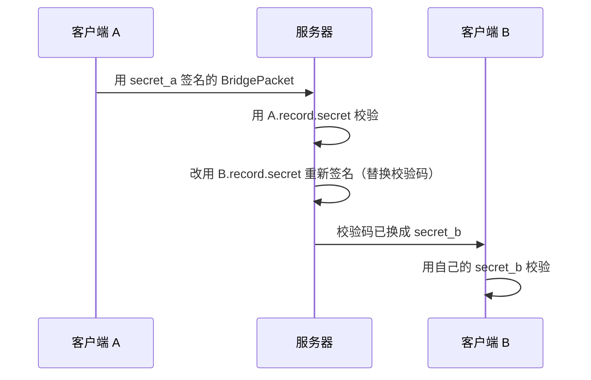

# 安全扩展（MIP）

核心协议只定义了消息包格式与传递方式，未规定上层安全措施。本扩展（Magpie Improvement Proposal）在服务器场景下增加 HMAC-SHA256 附加校验码与密钥化身份模型，防止转发消息被轻易伪造。

- [附加校验码](#附加校验码)
- [SDK 升级](#sdk-升级)
- [客户端密钥](#客户端密钥)
- [身份检查与活跃时间](#身份检查与活跃时间)
- [应答频率控制](#应答频率控制)
- [防放大攻击](#防放大攻击)
- [防反射攻击](#防反射攻击)
- [伪造身份威胁](#伪造身份威胁)
- [重放攻击](#重放攻击)


## 附加校验码

在原协议尾部追加 32 字节 HMAC-SHA256 校验前面的 header + payload。原包长度由此变为 `header_length + payload_length`，不再恒等于整个 UDP 包长度。

```
+-------------------------------+
|   header (8 ~ 32 字节)         |
+-------------------------------+
|   payload (0 ~ 1024 字节)      |
+-------------------------------+
|   attachment (0 或 32 字节)    |  HMAC-SHA256(header + payload)
+-------------------------------+
```

直连包（B=0）不需要校验码——其数据合法性由客户端应用负责。仅 `BridgePacket` 需要升级。

接收时计算 `tail = UDP 长度 - (header_length + payload_length)`：

| tail | 结果 |
|------|------|
| < 0 | 包不完整，丢弃 |
| 0 | 普通包（B=0 必须为 0） |
| 32 | 尾部存在校验码 → `ReliablePacket` |
| 其他 | 错误包，丢弃 |

MSS 校验作用于整个 UDP 载荷：`header + payload + attachment <= 1232`。满包发送时 `32 + 1024 + 32 = 1088`，距 MSS 余量 144 字节，仍足以覆盖一层中等开销隧道。


## SDK 升级

1. **MessagePacket**：增加 `copy()`，复制一份不携带 attachment 的包；
2. **BridgePacket**：增加 `sign(secret)`——先剔除原 attachment 打包，再计算 `hmacSha256(secret, data)`，返回带校验码的子类 `ReliablePacket`；
3. **ReliablePacket**：携带 `attachment`（32 字节），`verify(secret)` 用**常量时间比较**重算 HMAC 并比对（禁止直接 `==` 比较，防计时攻击）；
4. **MagpieParser**：解析时按 `tail` 分派——B=0 → `DirectPacket`；tail=0 → `BridgePacket`；tail=32 → `ReliablePacket`；其余丢弃。


## 客户端密钥

在本设计中，bid 仅与 socket 信息（ip:port）绑定，没有密钥或令牌的应用规范会派生出盲注册、冒充身份等问题。这里利用"客户端密钥"对消息进行校验。

### 密钥确认（握手阶段）

- 客户端发送 "SYN?"，服务器先检查其 socket 是否已有绑定记录：未存在则生成新的客户端密钥 secret（否则重用 record.secret），经 "SYN!" 连同 token 下发；
- 客户端保存密钥，在 "ACK!" 中原样回传，服务器校验通过后：记录已存在则更新 last_time；未存在则新建记录（写入 socket/secret，last_time 为当前时间）；
- 密钥确认只发生在握手阶段，此后所有消息包均不再携带此密钥，但都需用它签名/验签；
- 握手密钥以明文经链路下发，可能被链路上的攻击者嗅探。这里**不引入 ECDH 等密钥协商方式，是因为对链路攻击者（嗅探/中间人）无效**——除非引入客户端长期身份机制，否则对消息加密只会增加计算量、无收益；应在应用层对载荷加密（带认证），而非改造握手流程。

### 消息校验

此后每一次与服务器通信，发送方都用此密钥对消息包签名，接收方用同一密钥验证通过后方能继续。

> 对于没有携带附加校验码的消息（除 "SYN?"/"ACK!" 两个外），一律判定为伪造包，静默丢弃、不应答（正常数据包必定带校验码）。

### 消息转发



1. 客户端 A 先用自身密钥 S_a 对 BridgePacket 签名（计算校验码），按扩展协议打包发给服务器；
2. 服务器用 A.record.secret 验证，通过后继续处理；
3. 转发给 B 之前，用 **B.record.secret** 重新签名（替换原校验码）再发给 B；
4. B 用自身密钥 S_b 验证通过后继续处理。

> 接收方不知道发送方的密钥（只有发送方与服务器知道），所以服务器必须对转发消息重新签名，以便接收方确认消息由服务器转发。


## 身份检查与活跃时间

服务器收到 "ACK!" 后，通过验证 token 确认密钥已被客户端签收，将密钥写入 bid record（只在创建时写入，此后永不改变，直至记录被回收）。此后每个客户端发来的消息包都需用 record.secret 做身份验证。

**消息来源检查（附加校验方法）逻辑升级**（管理线程与转发线程各一处）：任务通过了来源检查且 record.bid == source 之后，提取 record.secret 对消息包做防篡改验证：

```dart
bool ok = (packet is ReliablePacket) && packet.verify(record.secret);
```

校验失败视为不可信来源，直接丢弃该包、不应答退出。

> 活跃时间 `record.last_time` 只在来源检查与附加校验码验证**全部通过之后**才更新；任何校验失败（来源不匹配、校验码错误）的包都不得刷新活跃时间，否则伪造包可借此变相保活。


## 应答频率控制

为防止攻击者利用服务器的应答逻辑频繁触发应答骚扰正常用户，通过**应答计数器**限制应答频率。应答频率控制**仅应用于连接未确认状态**（未绑定客户端）；握手阶段的 "SYN?"/"ACK!" 除外（受 `handshake_min_payload` 限制、不受计数器限制）；**已绑定客户端的应答不限频**。

### 应答计数器

每个计数器含计数变量（初始 `reply_rate_limit`，默认 10 次/秒）与刷新时间（初始为创建时间）。申请接口：当前时间超过刷新时间则重置计数并改写刷新时间为 1 秒后（懒刷新）；计数 > 0 则 -1 返回 true，否则返回 false。

### 未绑定客户端

预设共享数组 `shared_reply_counters`，长度 `unconfirmed_reply_buckets`（默认 1024）。未绑定的客户端准备应答前，先通过 `hash(socket) % U` 定位共享计数器并调用申请接口，返回 false 则不予应答。

> hash() 应选择非负整数且分布均匀的哈希函数（如字符串哈希取绝对值或使用无符号版本），保证各桶负载均衡；U 可由管理员配置，取模运算 % 保留。

### 已绑定客户端

已绑定 bid 的客户端**不设应答频率限制**，应答一律正常下发。

> 原因：已绑定客户端能触发应答的只有能通过消息校验的攻击者（嗅探者/重放者），他们可仅用 "FIN?" 一个指令触发无限应答（"FIN!" 为自愈通知，不可截断），限频其余应答并不能减少此类攻击造成的骚扰；反而可能被攻击者洪泛抢走额度，截断受害者自身的合法应答（"PONG"/"FAIL"），造成功能损害。此类洪泛退化为显性应答骚扰（响应 ≤ 请求、无放大缺口），受害者可感知并自愈。


## 防放大攻击

"放大攻击"是攻击者伪造受害者 socket 信息发送小 UDP 包，触发服务器向受害者应答更大的包，从而**放大**攻击流量。此类攻击不要求攻击者位于受害者与服务器之间的链路上，条件宽松，必须防住。

防放大方案应用在**握手阶段**（握手过程不能限制应答频率，否则会降低 DoS 攻击门槛，只能通过 `handshake_min_payload` 限制放大攻击）：

当管理线程取到 command == "SYN?" 或 "ACK!" 的任务时，先检查载荷长度是否达到 `handshake_min_payload`（默认 512 字节），未达到直接丢弃、不处理也不应答；客户端创建这两个指令包时必须填充 payload 超过 512 字节。

|        | Header | Payload | +UDP+IPv4 |
|--------|--------|---------|-----------|
| "SYN?" | 20     | 512     | 560       |
| "SYN!" | 20     | 192     | 240       |
| "ACK!" | 20     | 512     | 560       |
| "FAIL" | 20     | 19      | 67        |

两组数据包的放大比分别是 0.429 和 0.12（响应显著小于请求，无放大缺口）。


## 防反射攻击

"反射攻击"是攻击者伪造受害者 socket 信息发送数据包，触发服务器向受害者应答差不多大小的包，从而**洗白**攻击流量。防反射方案应用在除握手阶段以外的所有指令（含数据转发指令）：一旦检测到异常情况，直接丢弃不予处理。

### 连接未确认状态

两种例外：第三次握手 "ACK!" 丢失（服务器角度看握手未走完）；客户端换网络导致 socket 改变。此时服务器做来源检查找不到记录，按正常流程应回 "FAIL" 通知补发 "ACK!" 或重新握手——这就成了反射攻击窗口。

**针对系统指令**，管理线程回复 "FAIL" 之前必须同时满足三个条件：

1. 协议包后面带有 32 字节附加校验码，否则静默丢弃（正常用户数据包必带校验码）；
2. command 为 "PING"/"ACPT"/"DENY"（只有这 3 条系统指令需要错误提示），否则静默丢弃——注："FIN?" 不在此列，连接未建立时挥手无意义，静默丢弃即可；
3. 通过 `hash(socket) % U` 定位共享计数器，计数器允许才应答。

**针对转发指令**，转发线程回复 "FAIL" 之前必须同时满足两个条件：带 32 字节附加校验码；共享计数器允许。

### 连接已确认状态

握手完成、连接已确认的情况**不设应答频率限制**：管理线程正常应答；转发线程在发送方已被收件人接纳但收件人离线需回 "FAIL" 通知时正常回复。


## 伪造身份威胁

拥有嗅探能力的攻击者（恰好位于受害者与服务器之间的链路上，条件苛刻）可通过嗅探获得受害者密钥，伪装成受害者发送指令。

### 1. 恶意修改通行证

攻击者伪装受害者 A 发送 "ACPT"/"DENY"，服务器验证通过后修改 A.record.allowlist 并回 "DONE"/"FAIL"：

- 伪造 "DENY" 仅删除 A 侧映射；通行证为双向共享对象，对方记录中的有效通行证仍在，转发检查"任一边有效即放行"，单方删除不影响通信；
- 伪造清空（"DENY" 特殊载荷）同效：仅清空发起方单侧列表、不影响通信，可重新发送 "ACPT" 恢复；
- 伪造 "ACPT" 可添加恶意 bid 的通行证（攻击者再用该 bid 补全即生效），受害者无法单方解除（"DENY" 仅删自己侧），只能由应用层屏蔽，或重新握手更换 bid 摆脱。

allowlist 条目数设有上限 `allowlist_max_entries`（默认 1000），达到上限时 "ACPT" 整体拒绝（不添加任何 bid）并回复 "FAIL"，避免攻击者通过大量 "ACPT" 无限膨胀记录占用的内存。

正常用户收到这类应答时，应检查载荷中的 bid 列表并与本地 allowlist 比对：多出的条目（伪造添加）无法用 "DENY" 解除，可在应用层屏蔽，必要时重新握手换 bid；缺失的条目（伪造删除）不影响通信，需要时可重新发送 "ACPT" 恢复。

> 正常网络环境下，比对与恢复在 1 秒以内完成，攻击者无收益。

### 2. 踢人下线

攻击者伪装受害者 A 发送 "FIN?"，服务器将 A.record.offline 置为 true 并回 "FIN!"。

正常用户收到意外 "FIN!" 时（确认自己未发过 "FIN?"），应立即发送 "NOOP" 取消下线；服务器收到 "NOOP" 后将 offline 改回 false，并将 `record.last_noop_time` 更新为当前服务器时间。

在接下来的 `noop_immunity_window`（默认 2 秒）内，服务器对来自该客户端的 "FIN?" 一律忽略：不修改 offline、不应答。攻击者反复发送 "FIN?" 也无法将受害者持续踢下线。

> `last_noop_time` 未设置（该客户端从未发送过 "NOOP"）时，视为已超出免疫窗口，"FIN?" 不受限。

> 正常网络环境下，这个自愈机制在 1 秒以内完成，攻击者无收益。

### 3. 恶意保活

攻击者在受害者 A 实际已离线时持续发送 "PING" 强行保活，使服务器及 A 的好友误判其在线状态。由于受害者已不在线，此攻击在协议层**无解**，只能由应用层通过数字签名等机制判断——其他客户端在发送数据后，通过能否收到 "COPY" 应答及应答包内的数字签名是否正确来判断。

> "数字签名"属于应用层自行解决的问题，不在本协议定义范畴。

### 4. 冒充转发/恶意应答

攻击者嗅探到受害者 A 的所有信息、且 A 与 B 已相互添加通行证的前提下，可冒充 A 向 B 发数据或 "COPY" 等指令，导致 B 收到假数据，或 B 给 A 发数据时收到假 "COPY" 而 A 实际未收到。前者由应用层通过数字签名判断数据合法性；后者也可由应用层自定义 "COPY" 载荷格式加入数字签名防伪。

> 此类攻击即使没有数字签名防伪保护也影响不大：最多导致 B 误判 A 是否真的已收到（丢包概率很小），攻击者实际收益几乎没有。


## 重放攻击

由于当前所有服务器场景下的正常消息包（握手阶段除外）都带校验码，除链路攻击者外的其他攻击者无法冒充用户。但攻击者若获取到真实用户发送的消息包，再伪造来源地址重放，可能性很小但依然存在。

经评估，当前所有系统指令均为幂等语义（重复执行无新增效果），"FIN?" 重放仅造成 "FIN!"/"NOOP" 震荡（应答均不限频，自愈机制总能触发）。对于当前服务器支持的所有系统指令，**重放不会造成状态损害，无须额外防护**；转发数据包由接收客户端通过 sn + index 去重，重放攻击也无效（除了增加带宽消耗）。

因此，载荷中的 `"time"` 仅用于记录与展示，不参与校验和防重放。

> 如果用 "time" 进行额外的重放防护以减少带宽消耗，复杂度超过收益，故不引入。
