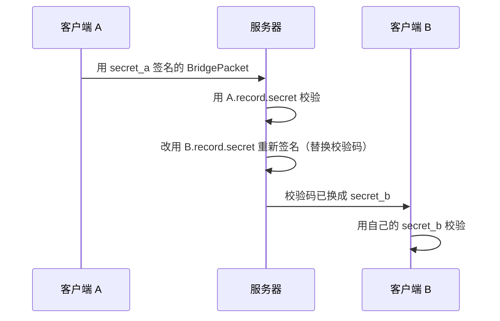

# 安全扩展（MIP）

核心协议只定义了消息包格式与传递方式，未规定上层安全措施。本扩展（Magpie Improvement Proposal）在服务器场景下增加 HMAC-SHA256 附加校验码与密钥化身份模型，防止转发消息被轻易伪造。

- [附加校验码](#附加校验码)
- [类层级升级](#类层级升级)
- [密钥模型](#密钥模型)
- [签名转发](#签名转发)
- [应答频率限制](#应答频率限制)
- [防放大攻击](#防放大攻击)
- [防反射攻击](#防反射攻击)
- [伪造身份威胁](#伪造身份威胁)


## 附加校验码

在原协议尾部追加 32 字节 HMAC-SHA256 校验前面的 header + payload。原包长度由此变为 `header_length + payload_length`，不再恒等于整个 UDP 包长度。

```
+-------------------------------+
|   header (8 ~ 32 字节)         |
+-------------------------------+
|   payload (0 ~ 1024 字节)      |
+-------------------------------+
|   attachment (0 或 32 字节)    |  HMAC-SHA256(header + payload)
+-------------------------------+
```

直连包（B=0）不需要校验码——其数据合法性由客户端应用负责。仅 `BridgePacket` 需要升级。

接收时计算 `tail = UDP 长度 - (header_length + payload_length)`：

| tail | 结果 |
|------|------|
| < 0 | 包不完整，丢弃 |
| 0 | 普通包（B=0 必须为 0） |
| 32 | 尾部存在校验码 → `ReliablePacket` |
| 其他 | 错误包，丢弃 |

MSS 校验作用于整个 UDP 载荷：`header + payload + attachment <= 1232`。满包发送时 `32 + 1024 + 32 = 1088`，距 MSS 余量 144 字节，仍足以覆盖一层中等开销隧道。


## 类层级升级

扩展层在原有 `MessagePacket → BridgePacket / DirectPacket` 基础上，增加一个带校验码的子类：

```
MessagePacket (基类，新增 copy())
  ├── DirectPacket   (直连包，无需签名)
  └── BridgePacket   (桥接包，新增 sign(secret))
        └── ReliablePacket  (带 attachment，新增 verify(secret))
```

**1. MessagePacket 新增 `copy()`**：复制当前包副本（不含 attachment），供签名/验签时重新打包用。

```dart
// 基类方法，所有包类型继承
MessagePacket copy();
```

**2. BridgePacket 新增 `sign(secret)`**：用客户端密钥对基础包签名，返回 `ReliablePacket`。

```dart
class BridgePacket extends MessagePacket {
  ReliablePacket sign(Uint8List secret) {
    final data = copy().pack();                  // 剔除 attachment，打包基础包
    final digest = hmacSha256(secret: secret, message: data);
    return ReliablePacket(data, /* ...原字段... */ attachment: digest);
  }
}
```

**3. ReliablePacket 新增 `attachment` 字段和 `verify(secret)`**：验签，常量时间比较防计时攻击。

```dart
class ReliablePacket extends BridgePacket {
  final Uint8List? attachment;                   // 32 字节 HMAC-SHA256

  bool verify(Uint8List secret) {
    final digest = attachment;
    if (digest == null || digest.length != 32 || secret.isEmpty) return false;
    final computed = hmacSha256(secret: secret, message: copy().pack());
    return constantTimeByteEq(digest, computed); // 禁止直接用 ==
  }
}
```

> `DirectPacket`（B=0）不需要签名——直连场景的数据合法性由客户端应用层负责。


## 密钥模型

- **服务器密钥**：仅用于签发/校验握手 token，存于内存，轮换（见 [server.md](server.md)），永不外发。
- **客户端密钥**：握手阶段由服务器生成、经 `SYN!` 下发，客户端与服务器各持一份；握手后所有通信包都用它签名。record 生命周期内固定不变。

`ACK!` 建立记录后，客户端发出的每个包都必须是可用 `record.secret` 验证的 `ReliablePacket`。不带校验码的包（`SYN?`/`ACK!` 除外）一律视为伪造，静默丢弃。


## 签名转发



接收方不知道发送方的密钥，因此服务器在转发前要用收件人的密钥重新签名。

管理线程与转发线程都在来源校验通过后立即执行此检查：

```dart
final ok = packet is ReliablePacket && packet.verify(record.secret);
```


## 应答频率限制

懒刷新计数器：

- 计数初值为 `reply_rate_limit`（默认 10 次/秒），刷新时间为创建时刻；
- 申请时：若当前时间 > 刷新时间，计数器重置为上限，刷新时间后推 1 秒；
- 计数器 > 0 则减一并放行，否则丢弃。

两类对象：

- **未绑定发送方**（socket 查不到 bid record）：共享桶 `shared_reply_counters[hash(socket) % U]`，U = `unconfirmed_reply_buckets`（默认 1024）。伪造的未绑定来源每秒每桶最多触发 `reply_rate_limit` 次 FAIL 应答。
- **已绑定客户端**：每个 bid record 内挂一个专属 `reply_counter`，随 record 创建、随回收销毁。即使攻击者嗅探到受害者密钥，也能通过计数器限制反射流量。


## 防放大攻击

握手阶段不能限制应答频率（否则会降低 DoS 门槛），因此通过 `handshake_min_payload` 限制放大比。收到 `SYN?` / `ACK!` 时先检查载荷长度 >= 512，不足直接丢弃、不应答。

| 包 | Header | Payload | UDP+IPv4 合计 |
|----|--------|---------|---------------|
| SYN? | 20 | 512 | 560 |
| SYN! | 20 | 192 | 240 |
| ACK! | 20 | 512 | 560 |
| FAIL | 20 | 22 | 70 |

放大比分别为 0.429 和 0.125——响应显著小于请求，无放大缺口。


## 防反射攻击

握手之外的所有指令（含转发指令）都做应答频率限制。

### 未绑定（连接未确认）

管理线程回复 `FAIL` 前须同时满足：

1. 包尾带有 32 字节附加校验码；
2. command 属于 `PING` / `ACPT` / `DENY`（仅此三条系统指令需要错误提示；`FIN?` 不在此列——连接未建立时挥手无意义，直接静默丢弃）；
3. 通过 `hash(socket) % U` 命中的共享计数器放行。

转发线程回 `FAIL`（target 离线）要求满足第 1、3 条。

### 已绑定

直接使用 record 上的专属计数器：

- 管理线程在发送任何应答（`DONE`/`FAIL`/`PONG`/`FIN!`）前；
- 转发线程在向已被接纳的发送方回 target 离线 `FAIL` 前。


## 伪造身份威胁

嗅探型攻击者（位于受害者与服务器之间的链路上）可获得受害者的 `record.secret`，从而冒充受害者发指令。剩余威胁与自愈机制：

| 威胁 | 效果 | 缓解 |
|------|------|------|
| 恶意修改通行证（ACPT/DENY） | DONE/FAIL 回显的 bid list 与本地不符 | 客户端比对本地 allowlist，重发 ACPT/DENY 恢复（亚秒级） |
| 踢人下线（`FIN?`） | record 标记 offline，收到 `FIN!` | 未主动发过 `FIN?` 即回 `NOOP`，一秒内清除 offline |
| 恶意保活（持续 `PING`） | 受害者实际离线却被误判在线 | 协议层无解；应用层通过 `COPY` 应答及其内数字签名判断 |
| 冒充转发 / 伪造 `COPY` | B 收到假数据，或收到假 ACK | 应用层数字签名（超出协议范畴）；`COPY` 载荷可由应用层自定义签名 |
