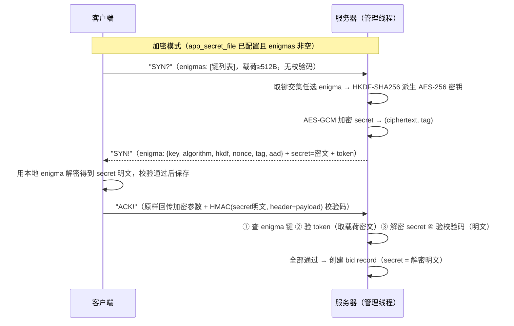

# Magpie Bridge 安全设计

核心协议只定义了消息包格式与传递方式，未规定上层安全措施。本设计在服务器场景下引入 **密钥化身份模型**（HMAC-SHA256 附加校验码 + 双向密钥）与 **应用密钥加密握手（Enigma）**，并针对放大攻击、反射攻击、伪造身份、恶意踢人等威胁逐项给出防护。本文档合并定义全部安全机制（基础防伪 + 扩展防护统一呈现）。

---

## 1. 威胁模型

| 威胁 | 攻击方式 | 危害 |
|------|----------|------|
| 包伪造 | 伪造 header/payload，冒充他人向服务器或目标发包 | 服务器无法验证来源，转发被冒充 |
| 整包重放 | 重放合法包（含校验码） | 干扰协议状态机（挥手/通行证） |
| 放大攻击 | 小请求换大应答，源地址伪造 | 服务器沦为攻击放大器 |
| 反射攻击 | 向服务器发送带伪造 source bid 的请求，使应答发往受害者 | 受害者收到大量垃圾应答/被干扰 |
| 链路嗅探 | 监听 UDP 链路 | 窃取握手阶段下发的 secret 明文 |
| 恶意踢人 | 冒充受害者发 "FIN?" | 服务器标记离线，中断服务 |
| 恶意保活 | 冒充离线受害者持续发 "PING" | 服务器与好友误判其在线 |
| 冒充转发 | 嗅探获钥后冒充受害者向好友发数据/应答 | 好友收到假数据或误判送达 |

防护原则：**伪造者拿不到密钥**（secret），所有校验都围绕"是否有权代表该 bid 发言"展开；攻击者通过服务器放大流量不划算（应答 ≤ 请求）；反射应答全部受控。

---

## 2. 密钥体系

| 密钥 | 变量名 | 长度 | 用途 | 存放 |
|------|--------|------|------|------|
| 服务器密钥 | server_secret | 默认 32B | 握手阶段对 token 签名 | 仅服务器内存（10 分钟轮换，保留最近 2 把） |
| 客户端密钥 | secret | 默认 32B | 对所有握手后消息签名/验签 | 双端内存，生命周期与 bid record 相同 |
| 应用密钥 | enigma | 任意长度 | 握手阶段对 secret 加密 | 服务器安全目录 + 客户端本地 |

- server_secret 轮换周期 `server_secret_rotate_interval`（默认 600 秒）；轮换期间保留旧密钥用于 token 校验，避免恰在握手中的客户端失败；
- secret 在 record 生命周期内**永不改变**；攻击者无需重新嗅探（除非受害者换网络）；
- enigma 由管理员预先指定、可靠渠道发放，非随机生成；客户端通过 "SYN?" 上报 enigma 键，服务器取交集任选其一，实现密钥轮换（过渡期新旧密钥同时保留）。

---

## 3. 消息校验（附加校验码）

所有与服务器通信的桥接包（B=1）在报文尾部追加 **32 字节 HMAC-SHA256 校验码（attachment）**：

```
verify = HMAC-SHA256(secret, header + payload)
```

- **直连包（B=0）不需要校验码**（数据合法性由应用层负责）；
- 转发包经服务器时，服务器用**接收方**的 secret 重新签名后转发，接收方据此确认"消息由服务器转发，来源 bid 可信"；
- 校验失败一律**静默丢弃、不应答**（避免给攻击者反馈）。

### 3.1 例外（握手阶段）

校验码用**接收方**的 secret 计算：接收方持有 secret 即必须携带，尚无 secret 则无从验证、不携带。按方向展开：

| 方向 | 包 | 是否带校验码 | 原因 |
|------|-----|-------------|------|
| 上行 | "SYN?" | 否 | 客户端尚无 secret |
| 上行 | "ACK!"（基础模式） | 否 | 回传 3 个握手参数已能证明持有 secret |
| 上行 | "ACK!"（加密模式） | **必须带** | 需证明客户端确实持有解密后的 secret，防止攻击者注册僵尸 bid record |
| 上行 | 其余（ACPT/DENY/PING/FIN?/NOOP/数据包等） | 必须带 | 客户端已持有 secret，防伪造 |
| 下行 | "SYN!" | 否 | 客户端尚无 secret，无从验证 |
| 下行 | "FAIL"（握手失败/连接未确认） | 否 | 客户端尚无 secret |
| 下行 | "FAIL"（接收方离线/通行证失败） | **必须带** | 请求方已持有 secret |
| 下行 | 其余（"PONG"/转发包等） | 必须带 | 接收方已持有 secret |

### 3.2 解析规则

UDP 包天然完整。按 header 解析后，比较实际包长与 `header_length + payload_length` 的差值：

- 既不是 0 也不是 32 → 错误包丢弃；
- = 0 → 无校验码，整体作为报文；
- = 32 → 前段为报文，尾部 32 字节为 attachment。

---

## 4. 握手安全

### 4.1 无状态令牌（Token）

握手采用**无状态**令牌设计，服务器在 "ACK!" 前不保存任何记录：

```
token = HMAC-SHA256(server_secret, "bid={bid}&secret={secret}&socket={socket}&time={token_time}")
```

- "SYN?" 阶段：服务器分配/复用 bid、生成 secret、计算 token，但不落任何状态；
- "ACK!" 阶段：服务器从包中取回 3 个参数（secret/token/token_time）+ 观察到的来源 socket，重算比对（依次尝试最近 2 把 server_secret），通过才创建记录；
- 攻击者可伪造 "SYN?"/“ACK!” 创建僵尸记录，但拿不到真正的 secret，无法冒充该 bid 发言（见 5.2）。

### 4.2 加密握手（Enigma）

应用密钥用于**在握手阶段加密 secret**，使链路嗅探者无法获得明文。服务器通过配置 `app_secret_file`（默认空）指向密钥文件；**未配置/文件不存在/`enigmas` 为空等均切换为非加密模式**，密钥文件非空才强制加密模式。



**服务器验证 "ACK!" 四步**（任一失败静默丢弃）：

1. "enigma" 字段不存在或其 "key" 与本地映射表无对应值 → 丢弃；
2. 按原握手流程校验 token（参与计算的 secret 取**载荷中的 "secret" 字段值**，即密文，无需先解密），校验失败 → 丢弃；
3. 用 "enigma" 信息解密 "secret"，解密失败（tag 校验不过）→ 丢弃；
4. 用解密得到的 secret 明文校验 attachment，失败 → 丢弃；全部通过后创建/复用记录，记录 secret 取解密值。

**运行期密钥重载**：管理线程按 `app_secret_reload_interval`（默认 600 秒）周期重读密钥文件——解析成功则整体替换映射表（轮换/吊销生效，空表切换为非加密模式）；**读取失败/文件消失则保留旧表继续运行**（不降级、不中断）。

> 关于不引入 ECDH 等密钥协商方式的说明：密钥协商类方案的目标是"为双方协商出一个共享密钥"；而本协议中 secret 本就由服务器生成、下发，对**链路攻击者（嗅探/中间人）而言，无论 secret 是否走协商流程，其价值都在于截获后冒充身份**。引入 ECDH 并不能让攻击者更难以截获/利用密钥，只会增加每次握手的计算与状态成本，因此这里采用"预共享应用密钥 + 离线加密"的设计。结论是：数据载荷应在**应用层加密（带认证）**，而非改造握手流程。

---

## 5. 伪造身份攻击防护

### 5.1 伪造来源（改包）

攻击者拿不到 secret，无法通过校验码验证，伪造包在服务器处即被丢弃；**若攻击者直接伪造应答包（如 "PONG"/"FAIL"）发给受害者**，因 UDP 无连接、来源可伪造，服务器无法阻止——此风险由应用层（端到端加密/签名）承担，协议层不解决。

### 5.2 僵尸 bid record（恶意注册）

攻击者可通过伪造 "SYN?"/“ACK!” 注册记录，但：

- 记录中的 secret 是服务器生成的随机值，攻击者不知道；
- 攻击者无法用该 bid 与服务器正常通信（校验码过不了）；
- 内存占用受 `max_records`（记录总数上限，默认 20000）控制：新建握手将创建记录时已达上限回 "FAIL"，配合 `record_expires`（24h 回收）控制，无法无限膨胀；
- 加密模式下 "ACK!" 必须带校验码，进一步杜绝"只注册不持有密钥"的僵尸。

### 5.3 伪造"FIN?"（恶意踢人）

攻击者冒充受害者发 "FIN?" 会把受害者标记 offline，中断转发。

**防护（NOOP 免疫窗口）**：记录维护 `last_noop_time`（最近一次 "NOOP" 时间，安全扩展属性）。收到 "FIN?" 时：

- 若 `now - last_noop_time < noop_immunity_window`（默认 2 秒），视为被攻击：仍应答 "FIN!"（挥手确认），但**不修改 offline**；
- 否则正常进入挥手流程（标记 offline + 应答 "FIN!"）。

正常客户端在空闲超过 H（10s）时发送心跳（"PING" 或 "NOOP"）；被踢后客户端可立即发 "NOOP" 刷新免疫时间（2 秒窗口）续期免疫窗口，恢复在线；客户端若持续发送 "NOOP"（如每 1 秒一次），免疫窗口不断续期，攻击者反复发送 "FIN?" 便无法将受害者踢下线，数据转发也不受影响。

> 此机制只免疫 "FIN?"，不限制 "DENY"（连续挂断通话等正常行为可能连发 DENY，不应误伤）。

### 5.4 恶意保活

攻击者可以在受害者实际已离线的情况下，冒充其持续发送 "PING" 强行保活，使服务器及其好友误判其在线状态。

> 受害者已不在线，此攻击在协议层无解，只能由应用层通过数字签名等机制判断：其他客户端在发送数据后，通过能否收到 "COPY" 应答包及其数字签名来判断。

### 5.5 冒充转发/恶意应答

攻击者在嗅探到受害者的 secret、且其好友已与受害者相互添加通行证的前提下，可冒充受害者向好友发送数据，或冒充受害者发送 "COPY" 应答。

- 前者由应用层通过数字签名等机制判断数据合法性；
- 后者由应用层自定义 "COPY" 载荷格式、加入数字签名防伪。

> 此类攻击即使无数字签名保护影响也不大：最多导致好友误判受害者是否真的收到（丢包概率很小），攻击者实际收益几乎没有。

### 5.6 socket 复用（身份接管）

bid 与 socket 绑定（socket 即身份，见架构文档）；若某 record 在其生命周期（默认 24 小时）内，原 "ip:port" 被 NAT/运营商重分配给另一用户，该用户通过正常握手可复用原 bid 与原 secret（见架构文档"复用记录"流程），从而接管原身份：可冒充其发送指令，其好友转发的数据也会送达新持有者。

> 现实性较低（需恰好重分配且恰好连接同一服务器，原用户通常已离线），协议层不做额外防护；同"冒充转发"，由应用层数字签名兜底。

---

## 6. 恶意修改通行证

攻击者冒充受害者发送 "ACPT"/"DENY"，可：

- **恶意 ACPT**：添加大量 bid 撑满 allowlist → 内存占用与通行证污染；也可添加恶意 bid 的通行证（攻击者再用该 bid 补全即生效），受害者无法单方解除（"DENY" 仅删自己侧），只能由应用层屏蔽，或重新握手更换 bid 摆脱；
- **恶意 DENY**：删除受害者的通行证 → 好友数据包被拒收（仅删发起方一侧，对方记录中的有效通行证仍在，通信不受影响，见 6.2）。

### 6.1 allowlist 上限

每条记录的通行证列表上限 `allowlist_max_entries`（默认 1000）。ACPT 中空间不足的条目被跳过（不写入 A 侧、在应答中回显失败子集），其余条目照常生效，限制内存冲击，恶意 ACPT 无法无限膨胀。

### 6.2 双向删除模型（防伪造删除）

- **单方 DENY 只删发起方一侧**（`X.record.allowlist.remove(Y)`），对方记录中的有效通行证仍在——攻击者删掉受害者一侧后，因通行权检查是**双向查找**（见架构文档 8.4），好友依然可发送；
- 彻底解除需双方均 DENY；单方拒收（拉黑）由应用层处理；
- 通行证检查时先查发送方记录、再查接收方记录，**任一边查到有效且来源与目标双方的 socket 均匹配即放行**，攻击者伪造删除对通信的破坏被降到最低。

> 残余风险：若攻击者把受害者 allowlist 撑满（1000）后持续 DENY 好友 bid，新 ACPT 无法插入；正常客户端可 "NOOP" 刷新免疫窗口后发 `[-1, -2, -3]` 清空重建。应用层应记录自己的好友 bid 列表以便恢复。

### 6.3 收到应答后的比对恢复

正常用户收到通行证应答（"DONE"/"FAIL"）时，应检查载荷中的 bid list 并与本地实际的 allowlist 比对：

- **多出的条目**（伪造添加）：无法用 "DENY" 解除（对方侧仍有效），可在应用层屏蔽，必要时重新握手换 bid；
- **缺失的条目**（伪造删除）：不影响通信（对方记录中的通行证仍有效），需要时可重新发送 "ACPT" 恢复。

> 正常网络环境下，比对与恢复在 1 秒以内完成，攻击者无收益。

---

## 7. 应答频率控制（共享计数器）

服务器对"连接未确认"的回复（主要是 "FAIL"）做全局限频，防止攻击者伪造 source bid 触发大量应答反射到受害者。应答频率控制**仅应用于连接未确认状态**；握手阶段（"SYN?"/"ACK!"）除外——其应答分别为 "SYN!"/"FAIL"（成功无应答），受 `handshake_min_payload` 限制、不受计数器限制。

- 服务器维护**共享计数器**：每收到一个来源无记录的请求包，按 `hash(socket) % U` 定位计数器并累加；
- 计数器按时间分桶（`unconfirmed_reply_buckets`，默认 1024 桶），懒刷新滑动窗口统计每秒请求数（每桶独立计数）；
- 请求速率超过 `reply_rate_limit`（默认 10 次/秒）时，不再回复 "FAIL"（静默丢弃）；
- 已绑定客户端（记录存在且通过校验）的应答**不限频**（正常业务不受影响）。

> 已绑定客户端能触发应答的，只有能通过消息校验的攻击者（嗅探者/重放者）；限频 FAIL/PONG 等应答并不能减少此类攻击造成的骚扰，反而可能截断受害者自身的合法应答，故不设限。

---

## 8. 防放大攻击

服务器保证**应答包总大小 ≤ 请求包总大小**，避免被用作放大器：

| 场景 | 请求 | 应答 | 放大比 |
|------|------|------|--------|
| 握手 "SYN?" | ≥ 512B | "SYN!" ~430B（加密模式，enigma 参数+密文+token 等载荷构成；仍小于 512B 请求） | < 1 |
| 握手 "ACK!" | ≥ 512B | 无应答 | 0 |
| 连接未确认 | 任意 | "FAIL" 19B | < 1 |
| 数据转发 | 任意 | "COPY" 由应用层定义 | 无 |

- "SYN?"/"ACK!" 载荷长度不得少于 `handshake_min_payload`（默认 512），不满足直接丢弃；
- 转发线程不发数据应答（"COPY" 由接收方客户端直接回复），服务器不参与放大；
- 广播/组播来源地址在预处理阶段即丢弃，杜绝反射放大。

---

## 9. 防反射攻击

### 9.1 连接未确认

来源 socket 在分配表中无记录时，服务器回复 "FAIL" 前须通过以下检查（任一不满足即**静默丢弃**，不应答）：

1. **附加校验码**：管理线程与转发线程在回复 "FAIL" 前，均须确认协议包尾部带有 32 字节附加校验码，否则静默丢弃（正常用户数据包必带校验码）；
2. **指令白名单（仅管理线程）**：command 必须为 "PING"/"ACPT"/"DENY" 之一（只有这 3 条系统指令需要错误提示），否则静默丢弃——"FIN?" 不在此列，连接未建立时挥手无意义，直接静默丢弃即可、无需回 "FAIL"；
3. **共享计数器限频**：按 `hash(socket) % U` 定位计数器，通过限频检查（见第 7 节）才回复 "FAIL"。

不建立任何状态，无反射条件。

### 9.2 已绑定客户端

记录存在、但来源 socket 与记录 key 不匹配（bid 被伪造）：

- 按伪造来源处理，**静默丢弃**，不应答（不向伪造的 source bid 回任何包）。

### 9.3 被动应答不反射

所有 A=1 应答（"SYN!"/"ACK!"/"PONG"/"FIN!"/"DONE"/"FAIL"）都由接收方直接回给请求方 socket——攻击者只有把请求发到受害者 socket 才能收到应答，等于直接攻击，无放大无反射增益。

---

## 10. 重放攻击评估

系统指令（D=0）**无重放防护**：攻击者可整包重放 "FIN?"/"DENY" 等触发自愈机制，但：

- "FIN?" 受 NOOP 免疫窗口保护（5.3），重放无效；
- "DENY" 幂等（目标不存在视为成功），重放只会重复清除已清除的 bid；
- "ACPT"/"PING" 等均为幂等操作，重放不产生新状态；
- 数据包（D=1）重放由接收方应用层去重（sn + index 去重）。

**"time" 字段语义**：载荷中的 "time" 是发送方时间戳，仅用于记录与展示，**不参与防重放判断**（UDP 乱序 + 时钟不同步使时间窗校验不可靠）。重放防护依赖操作幂等性 + 免疫窗口，而非时间戳比对。

---

## 11. 配置项汇总（安全相关）

| 配置项 | 默认值 | 说明 |
|--------|--------|------|
| handshake_min_payload | 512 | 握手上行包最小载荷（防放大） |
| unconfirmed_reply_buckets | 1024 | 共享计数器时间分桶数 |
| reply_rate_limit | 10/s | 未确认来源的 "FAIL" 应答限频 |
| allowlist_max_entries | 1000 | 每条记录通行证列表上限 |
| max_records | 20000 | 内存记录总数上限（新建握手将创建记录时已达上限回 "FAIL"，仅内定流程豁免） |
| noop_immunity_window | 2.0s | "NOOP" 免疫窗口（防 "FIN?" 踢人；窗口内应答但不标记 offline） |
| server_secret_rotate_interval | 600s | 服务器密钥轮换周期 |
| app_secret_file | （空） | 应用密钥文件路径，配置示例 `# app_secret_file = /etc/magpie/private/enigma.json` |
| app_secret_reload_interval | 600s | 应用密钥重读周期 |
