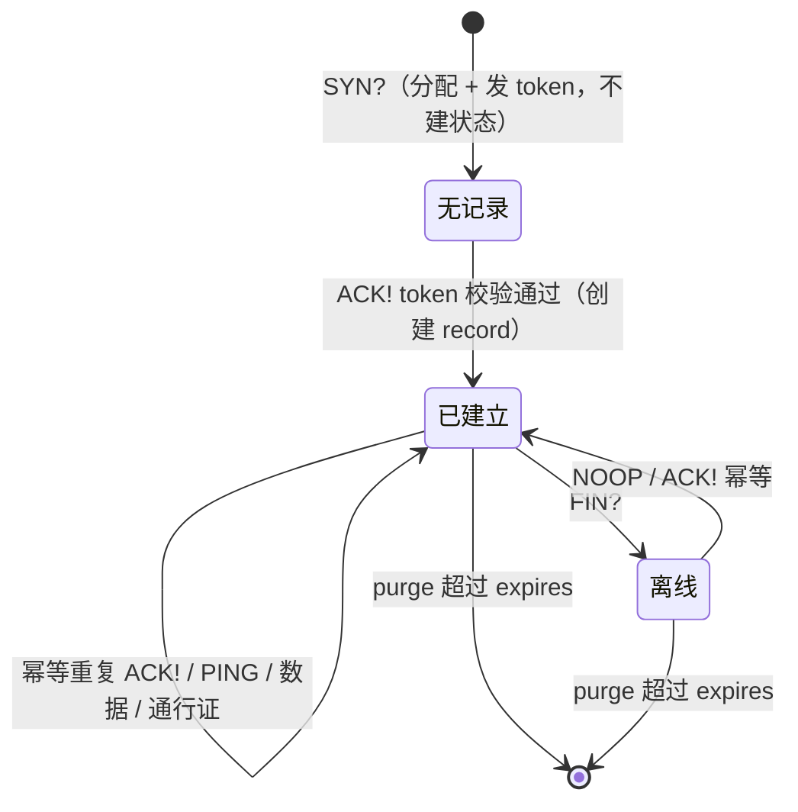

# 服务器实现

实现 [architecture.md](architecture.md) 中定义的服务器行为。

- [校验链](#校验链)
- [Bridge ID 管理](#bridge-id-管理)
- [记录生命周期](#记录生命周期)
- [密钥轮换](#密钥轮换)
- [流量控制](#流量控制)
- [启动与配置](#启动与配置)


## 校验链

> 只有管理线程和转发线程会更新记录活跃时间 `last_time`（管理线程在系统指令验证通过后、转发线程在来源 socket 预检后更新）；预处理线程只负责分拣，不查表、不更新。

### 预处理线程

| 检查项 | 失败处理 |
|--------|----------|
| 来源为广播/多播地址（`224.0.0.0/4`、`255.255.255.255`、`ff00::/8` 等） | 静默丢弃（防放大攻击） |
| Magic Code 不匹配 | 静默丢弃 |
| 按标志位重算的 N 与 `header_length` 不符 | 静默丢弃 |
| `N + payload_length` 与实际长度不符（附加校验码格式校验见附加校验码文档） | 静默丢弃 |
| C=1 但 command == 0 | 静默丢弃 |
| D=0 但 E>0 | 静默丢弃 |
| D=1 但 sn == 0 | 静默丢弃 |
| E>0 但 count <= 1 或 index 越界（0 <= index < count） | 静默丢弃 |
| 发给服务器/求转发的包不是 B=1 | 静默丢弃 |
| target != 0 且 source == 0 | 静默丢弃（客户端不得伪造来源为服务器的包） |
| target != 0 且 target == source | 静默丢弃（不能自己发给自己） |

预处理阶段**不校验 command 具体取值**（是否系统指令、如何应答由管理线程按场景处理，客户端自定义 command 亦不受限）。

### 管理线程

- "SYN?"：第一次握手（唯一允许 source=0 的场景）；分配 bid、生成 secret 与 token；**不创建任何记录**（无状态）；
- "ACK!"：第三次握手（无状态验证）；校验 token、查询分配表；直到此步结束新 bid record 才会创建；
- 其他系统指令（要求 source > 0）：先做来源检查——连接未确认则先回 "FAIL"（应答受共享计数器限频，见安全扩展文档）再丢弃；source bid 不匹配直接丢弃；
- 凡记录已建立后收到的系统指令（"SYN?" 与 "ACK!" 除外），均须对**附加校验码**进行 HMAC-SHA256 校验（见安全扩展文档），校验失败视为不可信来源直接丢弃、不应答；
- **以上校验全部通过之后，更新活跃时间 `record.last_time = now`**，然后按 command 处理和应答；
- 已绑定客户端的应答不限频（见安全扩展文档）。

### 转发线程

每条转发线程只负责 source bid 与本线程编号对应的转发任务：

1. 先做来源检查——连接未确认则先回 "FAIL"（受共享计数器限频）再丢弃；source bid 不匹配直接丢弃；
2. 记录已建立后收到的数据包均须做附加校验码 HMAC-SHA256 校验，失败丢弃、不应答；
3. 来源校验通过之后**更新活跃时间** `record.last_time = now`，然后检查目标状态（见架构文档）；
4. 以上校验全部通过后，用接收方的 record.secret **重新对数据包签名**（见安全扩展文档），再执行转发。


## Bridge ID 管理

bid 为 32 位无符号整数，取高 16 位 H 与低 16 位 L 合并：

| H 区间 | bid 区间 | 用途 |
|--------|----------|------|
| 0 | 0 ~ 65535 | 内定保留区间（loopback 内定 bid = port） |
| 1 ~ 32767 | 65536 ~ 2147483647 | 普通分配与预订区间（当前启用） |
| 32768 ~ 65535 | 2147483648 ~ 4294967295 | 预留区间（当前不启用但合法，仅可能由客户端预订产生） |

设计要求：bid 与 socket 信息一一对应。socket 信息为 ip 和 port 两个值（类型 SocketAddress），作为 key 查询时为 `"{ip}:{port}"` 字符串。

### 生成规则

采用**全随机**方式：直接在 `0x00010000 ~ 0x7FFFFFFF` 之间取均匀随机整数（即 H=1~32767、L=0~65535 的全部组合）。

1. 取均匀随机整数 bid（65536 ~ 2147483647）；
2. 检查分配表，冲突则重新随机；
3. 重试达到 M 次（默认 16，可配置 `bid_allocation_retries`）仍冲突则暂时无法分配，由管理线程回 "FAIL"。

> 随机下限 0x00010000 保证不落入 0~65535 内定保留区间；随机上限 0x7FFFFFFF 保证不自动分配 H≥32768 的预留区间。可用空间约 21.47 亿；正常在线规模（万级）下碰撞概率不足万分之一，M 上限仅为极端情况的理论兜底（防止死循环），不代表"服务器已满"。

### 冲突判定

通过 bid 查询：记录不存在、或记录中 socket 信息相同则无冲突；记录中 socket 与当前不同则判定为冲突。记录回收仅由管理线程通过 purge 完成，其他线程不做超时覆盖判断。

### 内定与预订

- **内定**：来源 IP 为环回地址（loopback: 127.0.0.0/8、::1/128）且 "SYN?" 中 source=0 的客户端，直接用其端口 port 作为 bid（H=0）。内定 bid 与其他 bid 一样在 "ACK!" 验证通过后创建记录并参与超时回收；若被其他 socket 占用，回复 "FAIL"；
- **预订**：客户端（loopback 或外部来源）在 "SYN?" 中预设 source bid（非 0）即走预订流程：先检查合法性（**必须大于 65535**，不能预订保留给 loopback 的内定区间，不合法回 "FAIL"），再按该 bid 查表——记录存在（已被其他 socket 占用）回 "FAIL"，不存在（空闲）则采用该 bid；
- 客户端不能预订 H=0 的内定区间，即所有预订成功的 bid 必定大于 65535；预订 bid 不设上限（H 合法范围 0~65535），其中 H≥32768 属于预留区间，校验不拒绝但无特殊原因不要申请；loopback 客户端若想放弃"内定权利"（不想要 bid = port），在 "SYN?" 预设 source bid 走预订流程即可。


## 记录生命周期



握手采用**无状态**方式：

- "SYN?" 阶段服务器只做分配决策并计算验证令牌 token，**不创建任何记录**；
- 记录在 "ACK!" 验证通过后才创建（创建即已确认，secret 固定不变）；创建时同时建立两套索引（bid、socket 信息），方便查询。

若 "ACK!" 丢失，客户端发下一个包时因服务器查不到记录而收到 "FAIL"（连接未确认），据此补发 "ACK!" 或重新握手。

**回收（purge）**：管理线程每轮循环先执行回收检查——距上次调用超过 `record_recycle_interval`（默认 10 分钟）则调用 `purge(now)`，回收超过 `record_expires`（默认 24 小时，即 `last_time < now - expires`）的记录，并同时删除对应的 bid/socket 索引；随后从管理队列取出任务处理。

> 正常运营时分配表规模为在线用户数（万级），一次遍历毫秒级，10 分钟一次的摊销成本可忽略。实现上建议**先只读遍历收集过期记录、再统一删除**，以缩短可能的持锁时间。

- **不做惰性回收**：按 bid 或 socket 查询分配表时**不检查是否过期**，记录存在即按有效记录处理，过期记录的回收统一由 purge 完成；
- `T_active`（在线判定窗口，默认 60 秒）与 `expires`（回收时效，默认 24 小时）是两个不同参数：前者用于转发线程判断记录是否活跃（在线），后者用于管理线程回收超时记录。


## 密钥轮换

服务器维护一个密钥组 `server_secrets`（列表，初始化含一个密码学安全随机密钥）与最后生成时间 `last_secret_time`，用于计算/验证握手令牌：

- **生成 token 时**：若 `now - last_secret_time > server_secret_rotate_interval`（默认 600 秒），生成新随机密钥放入队头、更新 last_secret_time，并**只保留最近 2 个密钥**，然后取队头密钥计算；
- **验证 token 时**：取出全部密钥（最多 2 个）逐个重算比对，任一匹配即通过（旧 token 在旧密钥被轮换出列表之前仍可验证）。

由于 "SYN?" 阶段不创建任何记录，握手洪流不产生任何共享状态、不占用内存（防洪策略见安全扩展文档）。


## 流量控制

限流采用**滑动窗口**：每条转发线程在 `forward_window` 秒内最多处理 `forward_limit_per_window` 个任务，达到上限后本轮窗口不再取新任务；超过队列容量（`forwarder_queue_size`）的新任务直接丢弃并记录日志（由客户端可靠传输机制重试）。

当前默认配置下单线程上限 `4096 / 0.1s = 40960 包/秒`，8 条线程合计约 327,680 包/秒；单线程转发队列容量 65536（最坏约 64 MiB/线程，按满载荷 1KiB 计），足以缓冲约 1.6 秒突发流量。


## 启动与配置

命令行均为命名参数、全部可选：

```
magpie-bridge [--config=<FILE>] [--log-dir=/tmp]    (Python 版命令)
java -jar magpie-bridge.jar [--config=<FILE>] [--log-dir=/tmp]   (Java 版入口)
```

- `--config`：配置文件路径（缺省尝试默认路径）
- `--log-dir`：日志目录（默认为空，不写文件）

未知参数会打印用法提示并退出。默认配置文件路径：`/etc/magpie/config.ini`；未通过 `--config` 指定时尝试读取默认路径，文件不存在、段或键缺失时一律回退到代码默认值。

| 配置键 | 默认值 | 说明 |
|--------|--------|------|
| host | 0.0.0.0 | 绑定地址 |
| port | **9527** | 绑定端口 |
| socket_buffer_length | 4194304 | 内核 socket 接收缓冲（字节） |
| forwarders | 8 | 转发线程数 W |
| forward_limit_per_window | 4096 | 每窗口处理上限 |
| forward_window | 0.1 | 限流窗口（秒） |
| record_expires | 86400.0 | 记录回收时效（秒，24 小时） |
| record_recycle_interval | 600.0 | purge 最小间隔（秒，10 分钟） |
| record_active_timeout | 60.0 | 在线判定窗口 T_active（秒） |
| handshake_min_payload | 512 | 握手包最小载荷（字节，防放大） |
| unconfirmed_reply_buckets | 1024 | 未绑定客户端共享计数器桶数 |
| reply_rate_limit | 10 | 每桶每秒最大应答数 |
| allowlist_max_entries | 1000 | 通行证列表条目上限 |
| noop_immunity_window | 2.0 | NOOP 免疫窗口（秒） |
| server_secret_rotate_interval | 600.0 | 服务器密钥轮换间隔（秒，10 分钟） |
| handshake_token_timeout | 60.0 | 握手 token 有效窗口（秒） |
| bid_allocation_retries | 16 | bid 分配重试上限 M |
| waiting_queue_size | 4096 | 接收→预处理队列容量（任务数） |
| manager_queue_size | 1024 | 预处理→管理队列容量（任务数） |
| forwarder_queue_size | 65536 | 单条转发线程队列容量（任务数） |

规则说明：

1. 所有时间值均为浮点秒（如 0.1），代码内部自行转换毫秒等内部单位；
2. 容量类参数均为整数：`waiting_queue_size`/`manager_queue_size`/`forwarder_queue_size` 为任务数（任务即数据包与来源 socket 信息的封装），`allowlist_max_entries` 为条目数，`socket_buffer_length` 为字节数；
3. 所有键缺失、段缺失或文件缺失时均回退到代码默认值（host 0.0.0.0、port 9527、forwarders 8，与其余键行为一致）；
4. 命令行 `--config` 指定路径优先于默认路径；配置文件不存在时不报错，直接使用全部默认值。


## 工程目录

| 语言 | 工程根目录 | 说明 |
|------|-----------|------|
| Java | `magpie/server-java/` | Java 版服务器 |
| Python | `magpie/sdk-py/magpie_bridge/bridge/` | Python 版服务器与 Python 版 SDK 共用一个库 `magpie-bridge`；协议代码在 `protocol/`，工具类在 `magpie/`，服务器在 `bridge/` |

安装 Python 版后可通过命令 `magpie-bridge [参数]` 启动服务器（命令行入口 `magpie-bridge=magpie_bridge.bridge.run:main`）。

