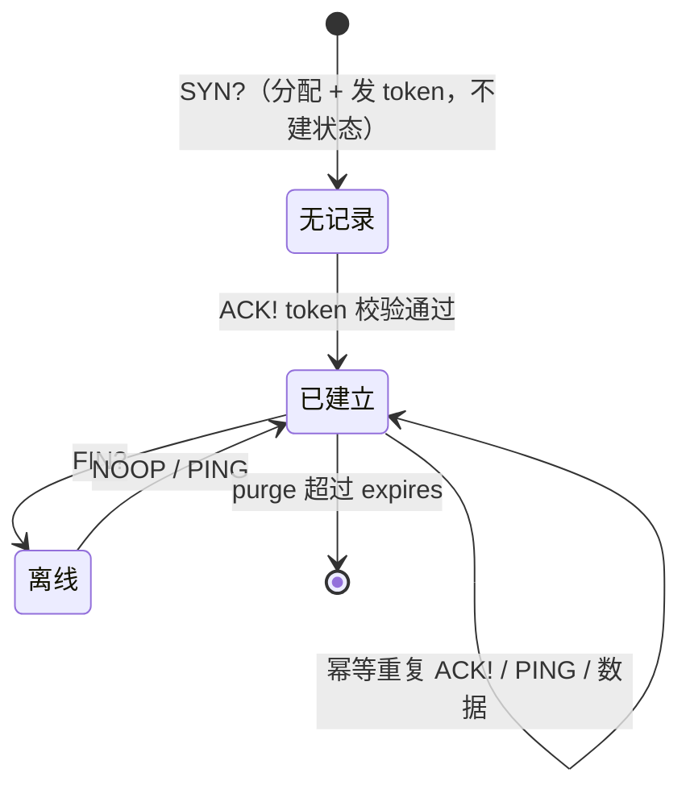

# 服务器实现

实现 [architecture.md](architecture.md) 中定义的服务器行为。

- [校验链](#校验链)
- [Bridge ID 管理](#bridge-id-管理)
- [记录生命周期](#记录生命周期)
- [密钥轮换](#密钥轮换)
- [流量控制](#流量控制)
- [启动与配置](#启动与配置)


## 校验链

### 预处理线程

| 检查项 | 失败处理 |
|--------|----------|
| 来源为广播/多播地址（`224.0.0.0/4`、`255.255.255.255`、`ff00::/8`） | 静默丢弃 |
| Magic Code 不匹配 | 静默丢弃 |
| 按标志位重算的 N 与 `header_length` 不符 | 静默丢弃 |
| `N + payload_length` 与实际长度不符（启用附加校验码后见 [security.md](security.md)） | 静默丢弃 |
| C=1 但 command == 0 | 静默丢弃 |
| D=0 但 E>0 | 静默丢弃 |
| D=1 但 sn == 0 | 静默丢弃 |
| E>0 但 count <= 1 或 index 越界 | 静默丢弃 |
| 发给服务器的包不是 B=1 | 静默丢弃 |
| target != 0 且 source == 0 | 静默丢弃 |
| target != 0 且 target == source | 静默丢弃 |

预处理阶段**不校验 command 具体取值**；未知命令由管理线程后续处理或丢弃。

### 管理线程

- `SYN?`：第一次握手（唯一允许 source=0 的场景）；分配 bid、生成 secret 与 token；**不创建记录**。
- `ACK!`：第三次握手，无状态 token 校验，通过后才创建记录。
- 其他命令要求 `source > 0`：来源校验 → 附加校验码 HMAC 校验 → 更新 `last_time` → 按 command 分发。
- 发送任何应答（`DONE`/`FAIL`/`PONG`/`FIN!`）前，先过应答频率限制。

### 转发线程

线程绑定规则：`线程 n = source_bid % W`。每个任务依次执行：来源校验 → HMAC 校验 → 更新发送方活跃时间 → target 查表 → 白名单 → target 存活判断 → 用 target.secret 重签 → 转发。


## Bridge ID 管理

bid 是 32 位无符号整数，分为高 16 位 H 与低 16 位 L。

- **H=0（0 ~ 65535）** 保留给 loopback 内部进程（见"内定规则"）。
- **H = 1..32767** 为常规自动分配与预订区间。
- **H = 32768..65535** 为预留区间，合法但仅可能由客户端预订产生。

### 分配规则

在 `0x00010000 (65536) .. 0x7FFFFFFF (2147483647)` 间取均匀随机整数：

1. 随机取一个 bid；
2. 与分配表冲突则回到第 1 步；
3. 连续 `bid_allocation_retries`（默认 16）次仍冲突，回 `FAIL`。

可用空间约 21.47 亿，万级在线规模下碰撞概率不足万分之一。

### 内定规则

来源为 loopback（`127.0.0.0/8`、`::1/128`）且 `SYN?` 中 source=0 的客户端，直接用本地端口作为 bid（H=0）。若该 bid 已被占用，回 `FAIL`。

### 预订规则

客户端在 `SYN?` 中填了非 0 source bid 即走预订流程：

- bid 必须 > 65535（不能预订内定区间）；
- 若 bid 已存在且 socket 不同（被其他客户端占用），回 `FAIL`；
- 否则采用该 bid（待 `ACK!` 验证通过后创建记录）。

loopback 客户端若不想用 `bid = port`，也可显式走预订。


## 记录生命周期

握手无状态：



- `purge(now)` 回收 `last_time < now - expires` 的记录，至少每 `record_recycle_interval` 运行一次。
- 查询分配表时**不做惰性过期判断**：记录存在即视为有效，回收统一由 purge 完成。
- **`expires`**（默认 24 小时）：回收时长。
- **`T_active`**（`record_active_timeout`，默认 60 秒）：转发线程判断 target 是否可达的存活窗口。
- `secret` 在记录创建后固定，直到回收都不轮换。


## 密钥轮换

`server_secrets` 至多保留 2 个随机服务器密钥与 `last_secret_time`。

- 生成 token 时：若 `now - last_secret_time > server_secret_rotate_interval`（默认 600 秒），在队头插入新随机密钥，仅保留最新 2 个。
- 校验 token 时：用全部最多 2 个密钥逐个重算比对，任一匹配即通过。旧 token 在旧密钥被轮换出列表前始终可验。


## 流量控制

每条转发线程滑动窗口限流：`forward_window` 秒内最多处理 `forward_limit_per_window` 个任务；队列溢出丢弃并记日志。


## 启动与配置

```
magpie-bridge [--config=<FILE>] [--log-dir=/tmp]
java -jar magpie-bridge.jar [--config=<FILE>] [--log-dir=/tmp]
```

未知参数打印用法后退出。默认配置路径 `/etc/magpie/config.ini`；文件/段/键缺失一律回退到代码默认值。

```ini
[magpie-bridge]
host = 0.0.0.0
port = 9527

# kernel UDP receive buffer (bytes)
socket_buffer_length = 4194304

# relay threads and sliding window
forwarders = 8
forward_limit_per_window = 4096
forward_window = 0.1

# record lifecycle
record_expires = 86400.0          # 24 h
record_recycle_interval = 600.0    # 10 min
record_active_timeout = 60.0      # T_active

# handshake anti-amplification
handshake_min_payload = 512

# reply rate limiting
unconfirmed_reply_buckets = 1024
reply_rate_limit = 10

# server secret rotation and handshake token
server_secret_rotate_interval = 600.0
handshake_token_timeout = 60.0
bid_allocation_retries = 16

# queue capacities
waiting_queue_size = 4096
manager_queue_size = 1024
forwarder_queue_size = 65536
```

所有时间值均为浮点秒。
