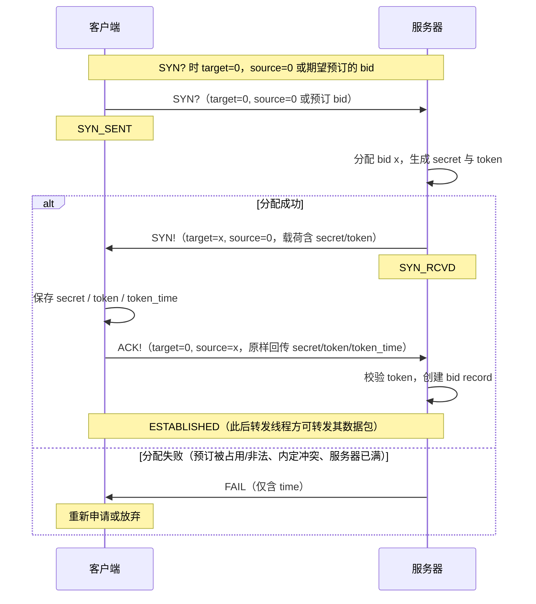
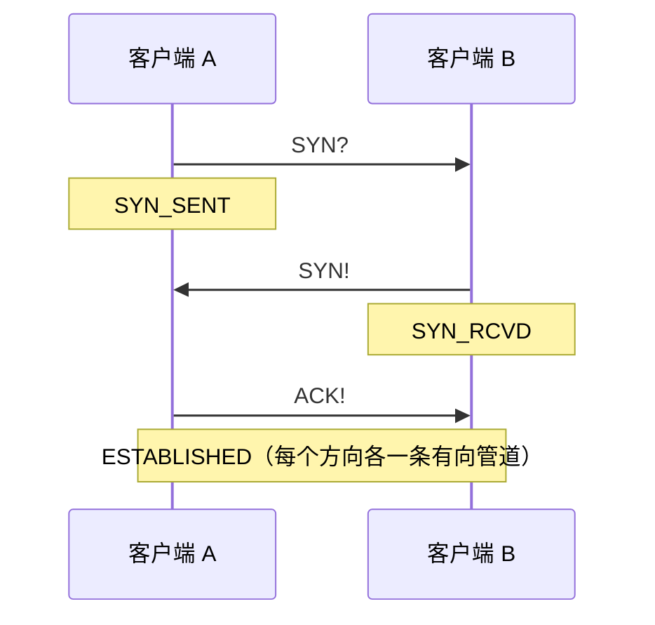
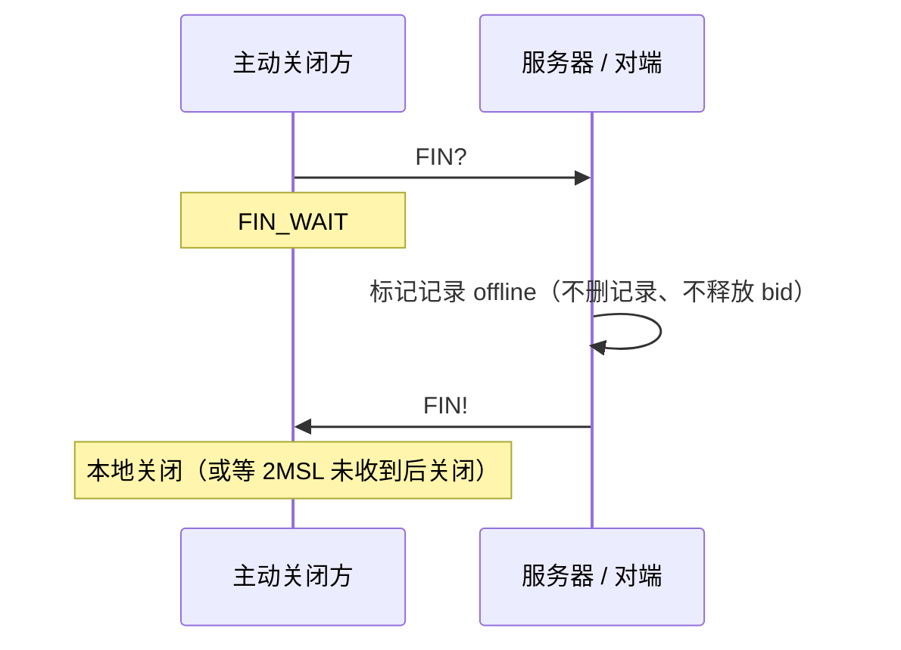
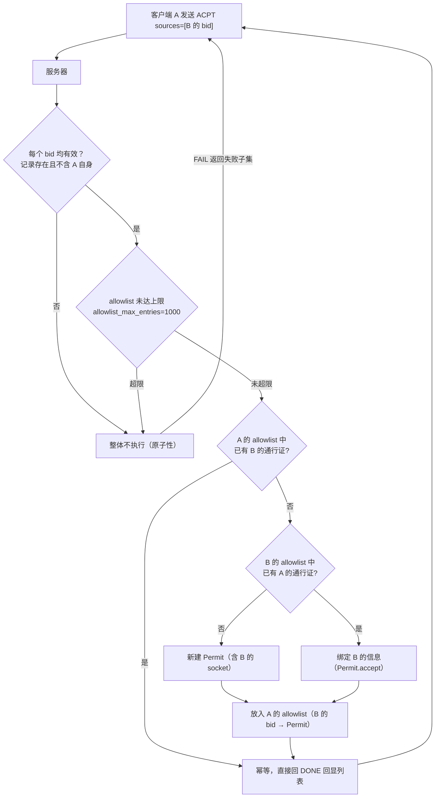

# 工作流程

角色分为**客户端**和**转发服务器**两种。两个客户端能直连时优先直连，否则通过服务器中转。各转发服务器彼此独立，客户端按连通速度自行选择。

- [握手（搭桥）](#握手搭桥)
- [关于 bid](#关于-bid)
- [挥手（关闭）](#挥手关闭)
- [通行证管理](#通行证管理)
- [发送数据](#发送数据)
- [应答机制](#应答机制)
- [心跳保活](#心跳保活)

> 系统指令（D=0）不携带 sn，应答按 socket 配对：从哪个 socket 收到请求，就回哪个 socket。source bid 不决定应答方向，仅用于身份校验。发送方无需为系统指令维护等待队列。
>
> 数据包（D=1）：直连（B=0）时收件人即对端 socket；桥接（B=1）时收件人由 target bid 指定。`COPY` 应答均按 sn + index 配对。

## 握手（搭桥）

客户端需先向服务器申请 bid（门牌号），此后其他客户端才能按 bid 请求服务器协助转发。客户端直连时无需 bid，但仍需握手以建立"连接"。

共三步：

| 步骤 | 标志位 | 命令 |
|------|--------|------|
| 第 1 次 | A=0, C=1, D=0, E=0 | "SYN?" |
| 第 2 次 | A=1, C=1, D=0, E=0 | "SYN!" |
| 第 3 次 | A=1, C=1, D=0, E=0 | "ACK!" |
| 失败 | A=1, C=1, D=0, E=0 | "FAIL" |

> B=1 表示与服务器握手；客户端直连握手时 B=0。失败行：服务器 bid 分配失败（预订被占用/非法、内定冲突、服务器已满）时以 "FAIL" 应答，由客户端自行决定重新申请或放弃。

### 客户端 -> 服务器

1. 第一次握手：客户端发送 "SYN?"，target=0，source 一般为 0（若使用预订机制可预设期望 bid），进入 SYN_SENT；
2. 第二次握手：服务器回复 "SYN!"，target 为按生成规则分配的整数 x，source=0（来自服务器），进入 SYN_RCVD；分配失败则回复 "FAIL"；
3. 第三次握手：客户端回 "ACK!"，target=0、source=x，载荷原样回传 "SYN!" 中的密钥与令牌；服务器验证令牌无误后创建 bid record（连接建立），此后转发线程方可转发其数据包。

### 客户端 -> 客户端（直连，B=0）

命令相同，但不带 bid 字段：

每个方向是独立的**有向管道**：A 收到 "SYN!" 并发出 "ACK!" 即标记自己的出方向管道已建立，B 收到 "ACK!" 时标记自己的入方向管道已建立——双方各管理一个单向"连接"。

## 关于 bid

服务器就是一个"桥"，帮助两个不能直接连接的设备转发数据包；bid 是客户端首次连接服务器时分配的一个整数（门牌号）。客户端申请到 bid 后需通过其他方式广播出去；其他用户发送数据时在 target bid 位置填上相应号码，服务器就会从注册表中找到对应 socket 并转发。

- target bid 为 0：服务器认为是发送给自己的（用于握手、挥手、通行证管理等指令）；
- B 通过服务器给 A 发数据时，必须申请自己的 bid 并放在 source bid 位置，A 才能知道是谁发的（用于生成自动应答以便 B 确认已收到）；不填则会被认为是来自服务器的包（0 为服务器保留值）；
- source bid 为 0 时只可能是服务器下发的包；B 发送 source=0、target≠0 的包会被服务器判定为上行校验违规直接丢弃；source bid 与服务器记录对不上（通过 bid 查记录再比对 socket）也会被丢弃；
- 服务器收到 target/source 均非 0 的包（两者不能相等）才认为是需转发的包，分别查询两个 bid 是否正确，正确则原样转发到 target 对应的 socket（不会对数据包做任何改动）。

## 挥手（关闭）

连接有超时机制判断存活状态，也可主动挥手关闭：

| 步骤 | 标志位 | 命令 |
|------|--------|------|
| 第 1 次 | A=0, C=1, D=0, E=0 | "FIN?" |
| 第 2 次 | A=1, C=1, D=0, E=0 | "FIN!" |

> B=1 表示向服务器挥手（断开连接）；客户端直连的挥手 B=0。

单条有向管道的挥手只有 2 步（"FIN?"/"FIN!"），直接关闭：

1. 主动关闭：客户端 A 数据发完后发送 "FIN?"（给服务器或对端），进入 FIN_WAIT；
2. 被动关闭：服务器（或对端）收到后，服务器场景先将记录标记为 offline，再回复 "FIN!"，然后关闭该侧连接；**不删除记录、不立即释放 bid**（记录仍按超时规则回收），转发线程据此立即感知客户端离线，无需等待活跃超时；
3. A 收到 "FIN!"（或等待 2MSL 未收到）后直接关闭。

> 客户端 to 客户端场景同时存在两条"有向管道"，每条都是发起方发 "FIN?" 后即可关闭；另一侧收到 "FIN?" 被动关闭该管道后，会接着主动发起反方向管道的关闭流程，总体上接近 TCP 的 4 次挥手。

## 通行证管理

通行证（Permit）是双方的"发送许可"，为**双向同意关系**：任一方添加、双方确认后生效，服务器才会将数据包转发给对方；单方 "DENY" 仅在发起方记录中删除映射，对方记录中的有效通行证仍在，通信不受影响；彻底解除需双方均 "DENY"；单方拒收（拉黑）由应用层处理。

| 步骤 | 标志位 | 命令 | 载荷 |
|------|--------|------|------|
| 添加 | A=0, B=1, C=1, D=0, E=0 | "ACPT" | bid 列表 |
| 撤销 | A=0, B=1, C=1, D=0, E=0 | "DENY" | bid 列表 |
| 成功 | A=1, B=1, C=1, D=0, E=0 | "DONE" | src-command, 原 bid 列表 |
| 失败 | A=1, B=1, C=1, D=0, E=0 | "FAIL" | src-command, 失败的 bid 子集 |

"ACPT" 添加流程（双向模型）：

1. 客户端 A 将需要接纳的发送方 bid 列表放入载荷，通过 "ACPT" 发给服务器（target=0、source=A 的 bid）；
2. 服务器逐个检查列表中 bid 是否有效（记录存在且不含发起方自身 bid）；任一无效则整体不执行（原子性），回复 "FAIL"（载荷为未通过校验的 bid 子集，未列出的 bid 视为可修改，但本次操作整体未执行）；全部有效则按添加流程执行（含上限检查，超限整体拒绝），回复 "DONE"（回显原 bid 列表）；
3. "DENY" 按删除流程执行（含清空标记判定；目标记录或通行证不存在亦视为成功，幂等），回复 "DONE"；
4. 转发线程转发前须确认发送方有权向 target 发送（先在发送方记录、再在 target 记录查找通行证，任一边查到有效且来源 socket 匹配即放行），否则静默丢弃（不应答、不转发，防止暴露收件人的存在与接纳状态）；
5. 通行证列表保存在建立方记录上（双向共享同一 Permit 对象），随记录回收自动删除；元素含双方 socket 信息，即使 bid 被回收后重分配给新客户端，也会因来源 socket 与通行证不匹配（Permit.match）而拒绝；
6. 管理指令（"ACPT"/"DENY"）建议串行发送（低频操作），客户端按载荷场景与回显内容识别应答归属。

## 发送数据

发送途径有两种：直接发送和通过服务器转发。

### 通过服务器转发

| 标志位 | Command | SN | Index, Count |
|--------|---------|----|--------------|
| A=0, B=1, C=0, D=1 | - | 自增值 | 实际分包信息 |
| A=0, B=1, C=1, D=1 | "DATA" | 自增值 | 实际分包信息 |

A 和 B 都必须在同一服务器注册 bid。发送方 A 将双方 bid 填入协议头相应位置，发送给服务器。

服务器检查：target bid 是否存在对应 socket 且活跃（记录未标记 offline、且在 `T_active` 窗口内有上行数据包；`T_active` 为"在线"判定窗口，默认 60 秒，与超时回收时效无关）；source bid 与当前 socket 匹配；发送方有权向 target 发送（通行证检查，见上）。全部通过后原样转发（发送方活跃时间已在转发线程通过来源 socket 预检后更新）；target 离线时的处理规则见服务器文档。

连接未建立（记录不存在，含收到 "SYN!" 后未回 "ACK!" 或 "ACK!" 丢失）时数据包不予转发：转发线程发现记录不存在或 socket 不匹配，以 "FAIL" 通知客户端并丢弃；记录不存在时客户端可直接补发 "ACK!"（幂等，token 未过期）或重新握手；socket 不匹配（来源地址已改变）时补发 "ACK!" 无法通过校验（token 绑定原 socket），须重新握手。

> 服务器协助转发时无需向发送方回复应答包，发送方通过接收方自动回复的应答包确认收到。

### 直接发送

| 标志位 | Command | SN | Index, Count |
|--------|---------|----|--------------|
| A=0, B=0, C=0, D=1 | - | 自增值 | 实际分包信息 |
| A=0, B=0, C=1, D=1 | "DATA" | 自增值 | 实际分包信息 |

两个客户端通过握手机制建立"连接"后，直接将数据打包发送给对方（B=0，无 bid 字段）。

## 应答机制

当客户端收到普通数据包（A=0, D=1，command 为 "DATA" 或无 command）时，均需回复数据应答包 "COPY"（A=1, D=1，回填源 sn 及 index/count）。系统指令（D=0）不回复 "COPY"，而是回复各自的专用应答（"SYN!"/"PONG"/"FIN!"/"DONE"，失败场景回复 "FAIL"）。

| 场景 | 标志位 | Command | SN | Index, Count |
|------|--------|---------|----|--------------|
| 服务器转发 | A=1, B=1, C=1, D=1 | "COPY" | 源值 | 源分包信息 |
| 直接发送 | A=1, B=0, C=1, D=1 | "COPY" | 源值 | 源分包信息 |

"COPY" 参数设置：

1. 将 type 最高位 A 置 1（应答）；
2. 若 B=1（经服务器转发），将 target 和 source 对调（发回同一个服务器中转）；
3. 令 C=1，command 设置为 "COPY"；
4. 若 D=1，sn 及可能存在的 index/count 保持不变；
5. 标志位 B/D/E 不变；
6. 载荷为空，也可携带自定义信息。

"FAIL" 的载荷按场景区分：

- **bid 分配失败**：客户端可选择重新申请或放弃；
- **连接未确认**（客户端漏发第三次握手 "ACK!"）：客户端可直接补发 "ACK!"（幂等，如果 token 未过期）；
- **target 离线**（转发线程发现收件人记录不活跃）：客户端据此通知上层"对端离线"即可，无需重试；
- **无法修改通行证**（"ACPT"/"DENY" 处理失败）：客户端可据此重试或放弃。

## 心跳保活

客户端定期检查自身收发时间，超过预设时间无任何收/发（含应答）则主动发送心跳包维持"连接"状态：

| 步骤 | 标志位 | 命令 |
|------|--------|------|
| 1 | A=0, C=1, D=0, E=0 | "PING" |
| 2 | A=1, C=1, D=0, E=0 | "PONG" |

- 心跳包发给服务器时 B=1（target=0, source=本机 bid）；客户端直连时 B=0；
- 服务器无需主动发起心跳，C-S 结构的连接状态由客户端负责维护；直连时两条"有向管道"各由发起方负责维护；
- "NOOP" 为无需应答的空操作指令，用于意外 "FIN!" 后的秒级保活自愈（见挥手机制），亦可作为一般的"无操作保活"（不会触发 "PONG" 应答）。
