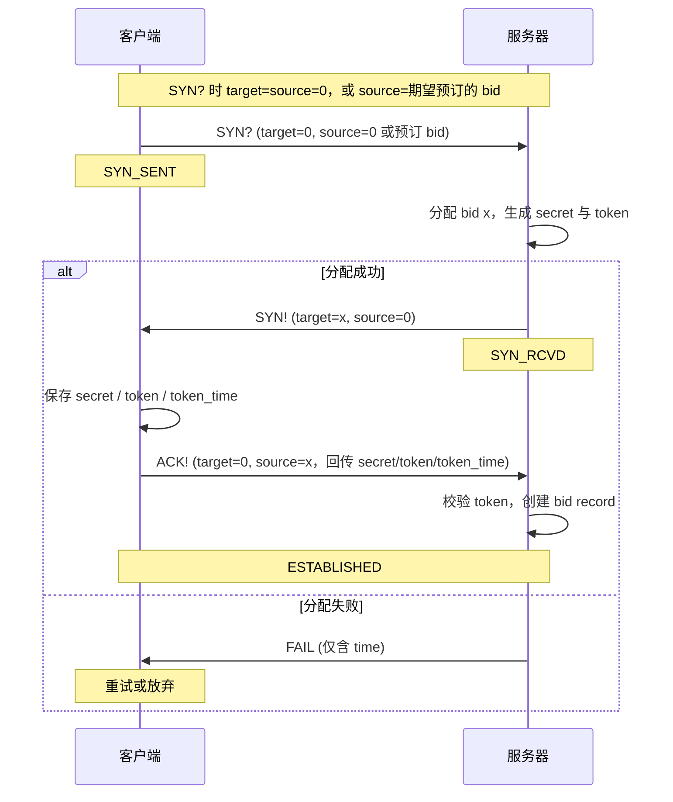
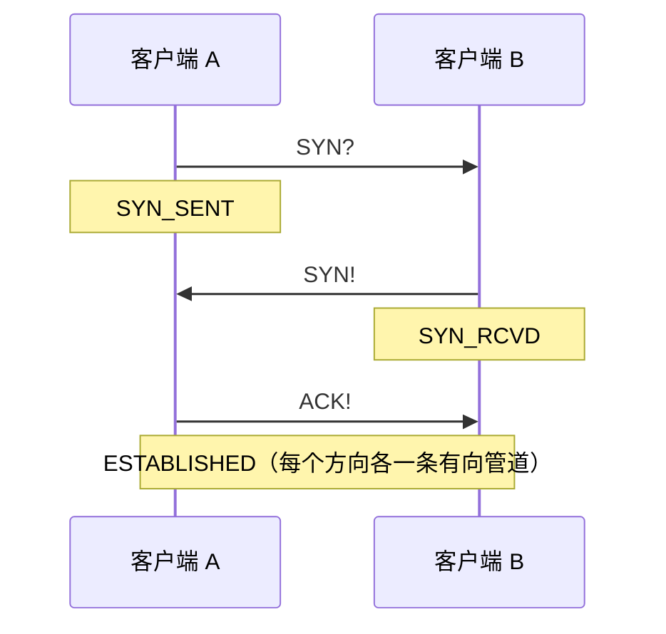
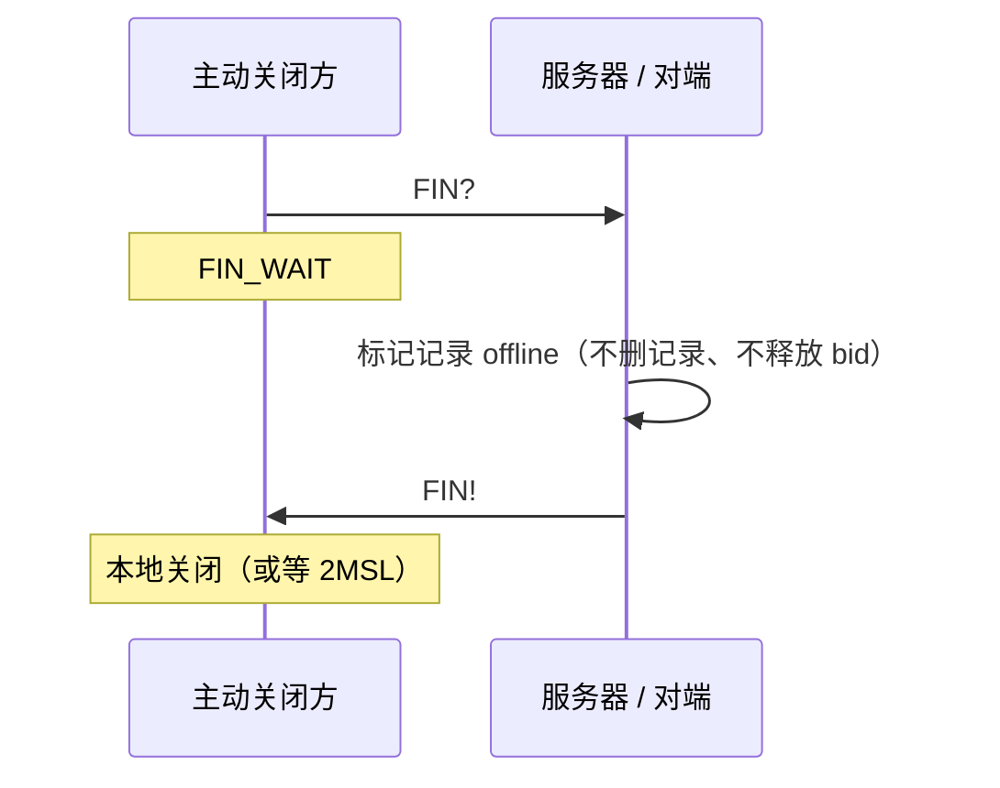
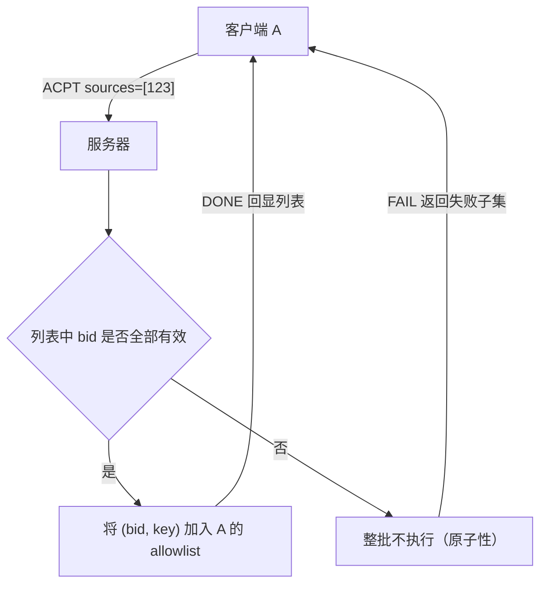

# 工作流程

角色分为**客户端**和**转发服务器**两种。两个客户端能直连时优先直连，否则通过服务器中转。各转发服务器彼此独立，客户端按连通速度自行选择。

- [握手（搭桥）](#握手搭桥)
- [关于 bid](#关于-bid)
- [挥手（关闭）](#挥手关闭)
- [通行证管理](#通行证管理)
- [发送数据](#发送数据)
- [应答机制](#应答机制)
- [心跳保活](#心跳保活)

> 系统指令（D=0）不携带 sn，应答按 socket 配对：从哪个 socket 收到请求，就回哪个 socket。source bid 不决定应答方向，仅用于身份校验。发送方无需为系统指令维护等待队列。
>
> 数据包（D=1）：直连（B=0）时收件人即对端 socket；桥接（B=1）时收件人由 target bid 指定。`COPY` 应答均按 sn + index 配对。


## 握手（搭桥）

客户端需先向服务器申请 bid（门牌号），此后其他客户端才能按 bid 请求服务器协助转发。客户端直连时无需 bid，但仍需握手以建立"连接"。

共三步：

| 步骤 | 标志位 | 命令 |
|------|--------|------|
| 第 1 次 | A=0, C=1, D=0, E=0 | `SYN?` |
| 第 2 次 | A=1, C=1, D=0, E=0 | `SYN!` |
| 第 3 次 | A=1, C=1, D=0, E=0 | `ACK!` |
| 失败 | A=1, C=1, D=0, E=0 | `FAIL` |

### 客户端 -> 服务器



1. **SYN?**：客户端请求连接，target=0；source 通常为 0，也可填期望预订的 bid。客户端进入 `SYN_SENT`。
2. **SYN!**：服务器为该 socket 分配整数 bid `x`，回复 target=`x`、source=0（来自服务器），进入 `SYN_RCVD`。分配失败（被占用/非法/内定冲突/服务器已满）时回复 `FAIL`。
3. **ACK!**：客户端回复 target=0、source=`x`，原样回传 secret/token/token_time。服务器校验 token 通过后创建 bid record，双方进入 `ESTABLISHED`，此后转发线程才会转发其数据。

### 客户端 -> 客户端（直连，B=0）

命令相同，但不带 bid 字段：



每个方向是独立的**有向管道**：A 发出 `ACK!` 后即标记自己的出方向管道已建立；B 收到 `ACK!` 后标记自己的入方向管道已建立。


## 关于 bid

服务器是一座"桥"，帮助两个无法直连的设备（例如一端在内网）中转数据包。bid 是首次注册时分配的 32 位整数门牌号。

- 客户端通过其他渠道广播自己的 bid；发送方在 target bid 填对方号码，服务器查表后转发。
- **target = 0** 表示发给服务器本身（握手、挥手、通行证、PING）。
- B 经服务器给 A 发数据时，必须把自己的 bid 放进 **source**，否则 A 无法识别发送方。
- **source = 0 保留给服务器下发的包**；客户端上行包若 source=0 而 target≠0，按上行违规丢弃。
- 服务器仅在 target/source 均非 0 且互不相等、两者记录均有效、source socket 匹配时才转发，且**原样转发**。


## 挥手（关闭）

连接本身有超时存活机制，但也可主动挥手关闭。一条有向管道的挥手仅两步（不同于 TCP 的四次）：



- 被动方将记录标记为 offline，回 `FIN!`，关闭自己这一侧；**不删除记录、不立即释放 bid**，记录仍按超时规则回收。转发线程可立即感知该客户端离线。
- 直连场景存在两条有向管道，各自发起方主动挥手，整体上等价于 TCP 四次挥手。


## 通行证管理

**通行证（pass）** 是收件人授予发送方的发送许可：收件人 A 通过 `ACPT` 将发送方 bid 加入白名单后，服务器才会把这些发送方的数据转发给 A；`DENY` 用于撤销。方向单向——A 接纳 B 仅表示 B 可发 A，反向需 B 另行接纳。

| 步骤 | 标志位 | 命令 | 载荷 |
|------|--------|------|------|
| 添加 | A=0, B=1, C=1, D=0, E=0 | `ACPT` | bid 列表 |
| 撤销 | A=0, B=1, C=1, D=0, E=0 | `DENY` | bid 列表 |
| 成功 | A=1, B=1, C=1, D=0, E=0 | `DONE` | 回显 bid 列表 |
| 失败 | A=1, B=1, C=1, D=0, E=0 | `FAIL` | 未通过校验的 bid 子集 |



规则：

1. A 把待接纳的 bid 列表放入载荷发给服务器（target=0，source=A 的 bid）。
2. 服务器逐个校验 bid 是否有效（记录存在）。**全部有效** → 将所有 `(bid, record.key)` 二元组加入 A 的 allowlist，回 `DONE` 回显原列表；**任一无效** → 整批不执行（原子性），回 `FAIL` 返回未通过子集。未列出但校验通过的 bid 视为"本次未操作"。
3. `DENY` 同构，且**幂等**（移除不存在的通行证也算成功）。
4. 转发前须确认 `(source bid, 当前 key)` 在 target 的 allowlist 中；否则静默丢弃（不应答、不转发，避免泄露收件人是否存在/已接纳）。
5. allowlist 保存在 target 记录上，随记录回收自动清理。元素为 `(bid, key)` 二元组——即使 bid 被回收后重分配，key 不匹配仍会被拒。
6. 管理指令建议串行发送（低频操作），客户端按载荷回显识别应答归属。


## 发送数据

两条路径：

| 路径 | 标志位 | 命令 | sn | 分包 |
|------|--------|------|----|------|
| 经服务器 | A=0, B=1, C=0/C=1, D=1 | — / `DATA` | 自增 | 实际 index/count |
| 直连 | A=0, B=0, C=0/C=1, D=1 | — / `DATA` | 自增 | 实际 index/count |

两个客户端必须先在同一服务器注册 bid。发送方填好双方 bid，服务器依次校验：target 记录存在、未标记 offline、在 `T_active` 窗口内活跃、source socket 匹配、`(source, key)` 在 target 的 allowlist 中。全部通过后原样转发，并更新发送方活跃时间。服务器不回独立应答，发送方通过收件人的 `COPY` 确认送达。

若 source 记录不存在（连接未确认，如 `ACK!` 丢失），服务器回 `FAIL` 并丢弃该包。客户端可补发 `ACK!`（token 有效期内幂等）；若 source socket 已变更，须重新握手。


## 应答机制

收到普通数据包（A=0, D=1）时，接收方必须回 `COPY`（A=1, D=1），原样回填 sn 与 index/count：

```
type = type | 0x80          // A = 1
if B=1: 交换 target <-> source
type = type | 0x20          // C = 1，command = COPY
sn / index / count 保持不变
载荷为空或由应用层自定义
```

系统指令（D=0）不触发 `COPY`，各有专用应答（`SYN!`、`PONG`、`FIN!`、`DONE`、`FAIL`）。

`FAIL` 场景与客户端处理：

| 场景 | 载荷 | 客户端动作 |
|------|------|-----------|
| bid 分配失败 | `{time}` | 重新申请或放弃 |
| 连接未确认 | `{src-command, time}` | 补发 `ACK!`（幂等，token 有效） |
| target 离线 | `{src-command, src-target, time}` | 通知上层；不重试 |
| 通行证修改失败 | `{sources:[...], time}` | 按失败子集重试或放弃 |


## 心跳保活

客户端通过距上次收发的时间判断是否需要发心跳。

| 步骤 | 标志位 | 命令 |
|------|--------|------|
| 请求 | A=0, C=1, D=0, E=0 | `PING` |
| 应答 | A=1, C=1, D=0, E=0 | `PONG` |

- 桥接时 PING 带 B=1（target=0，source=本机 bid）；直连时 B=0。
- 服务器不主动发心跳，C-S 连接状态由客户端维护。直连时每条有向管道由其发起方维护。
- `NOOP` 是不应答的空操作，用于意外收到 `FIN!` 后的秒级自愈。
