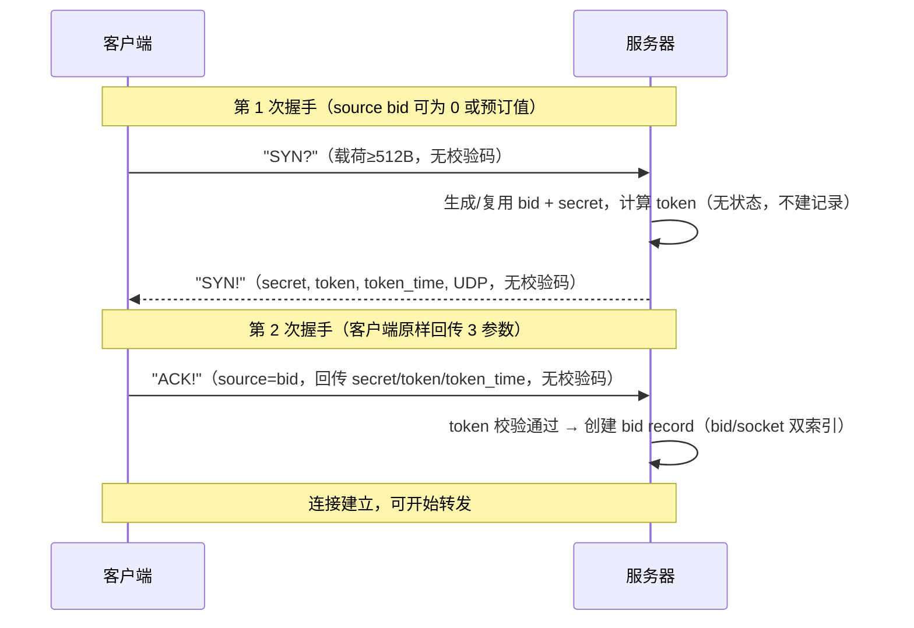
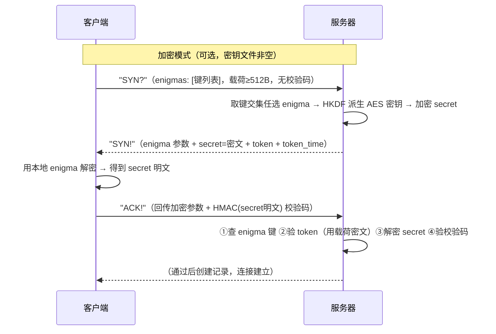
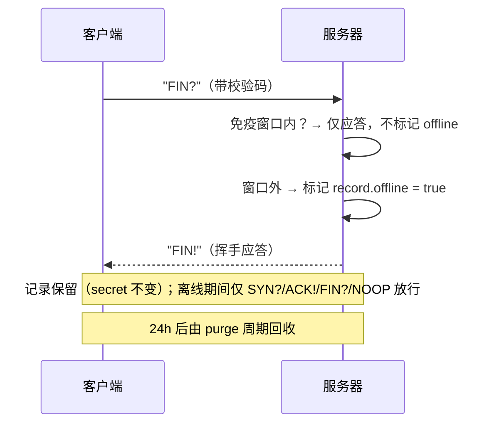
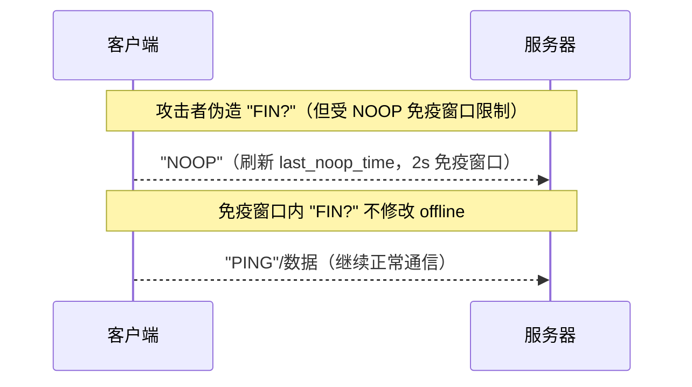
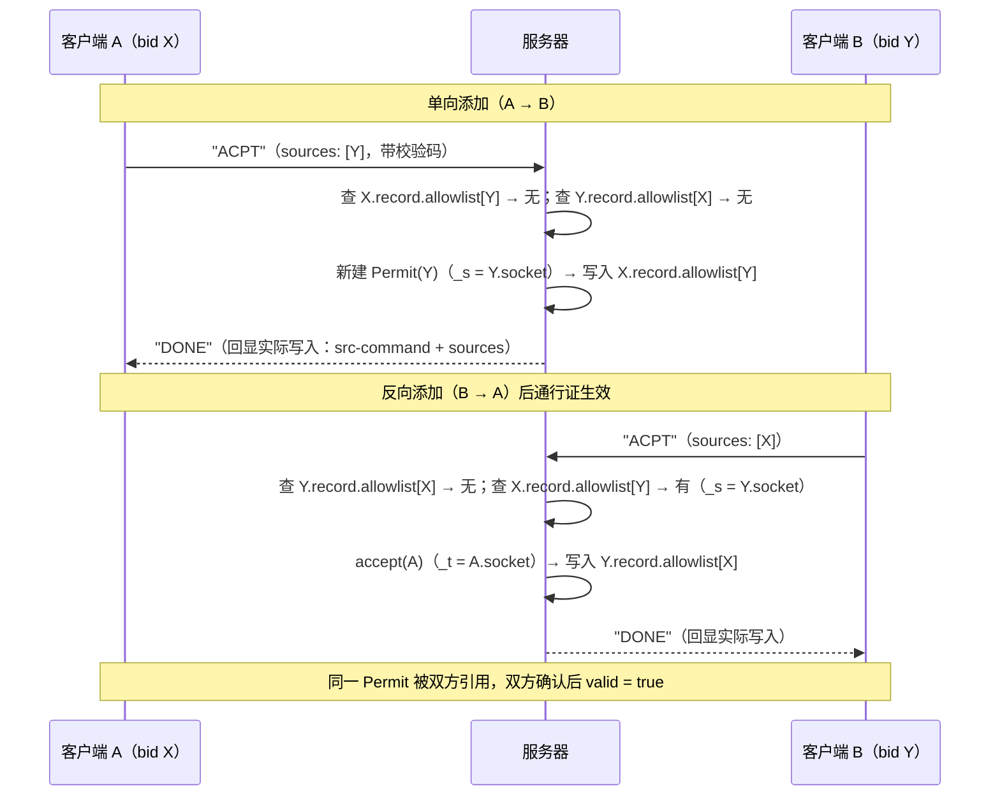
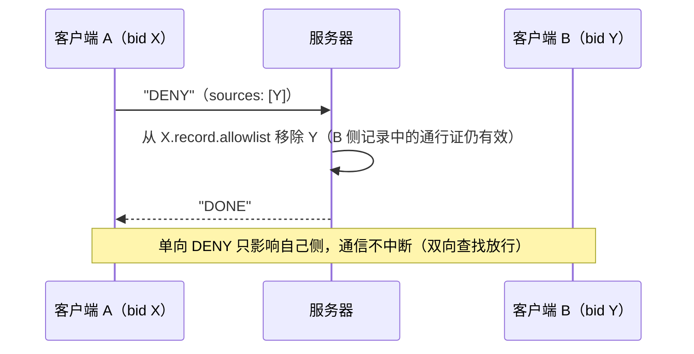
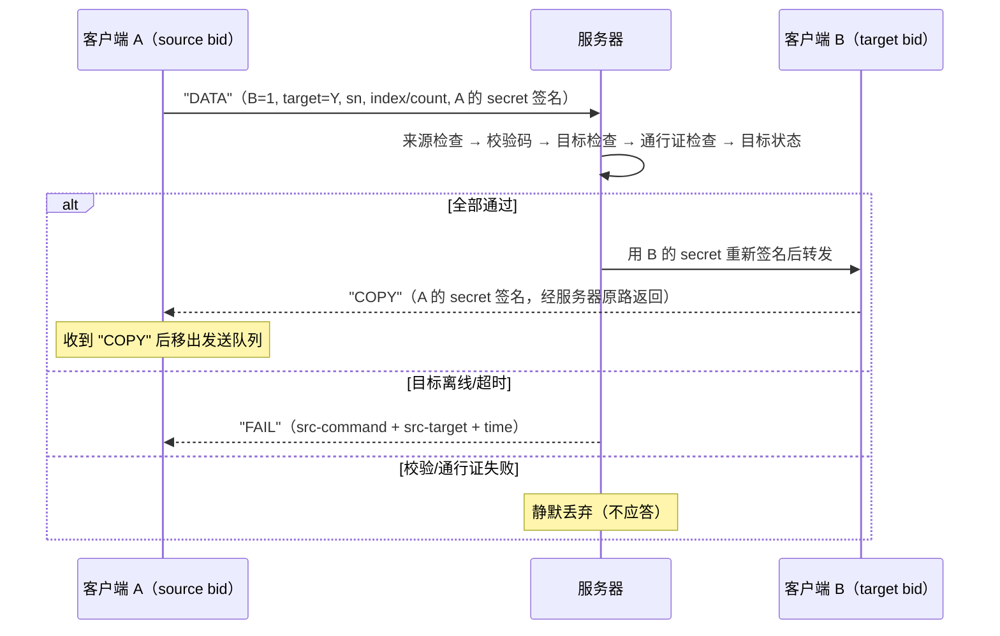
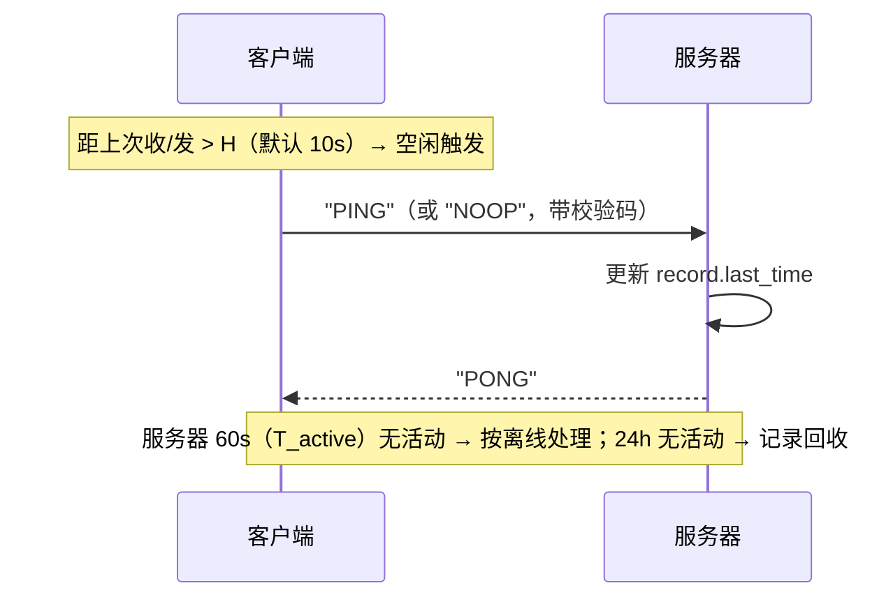
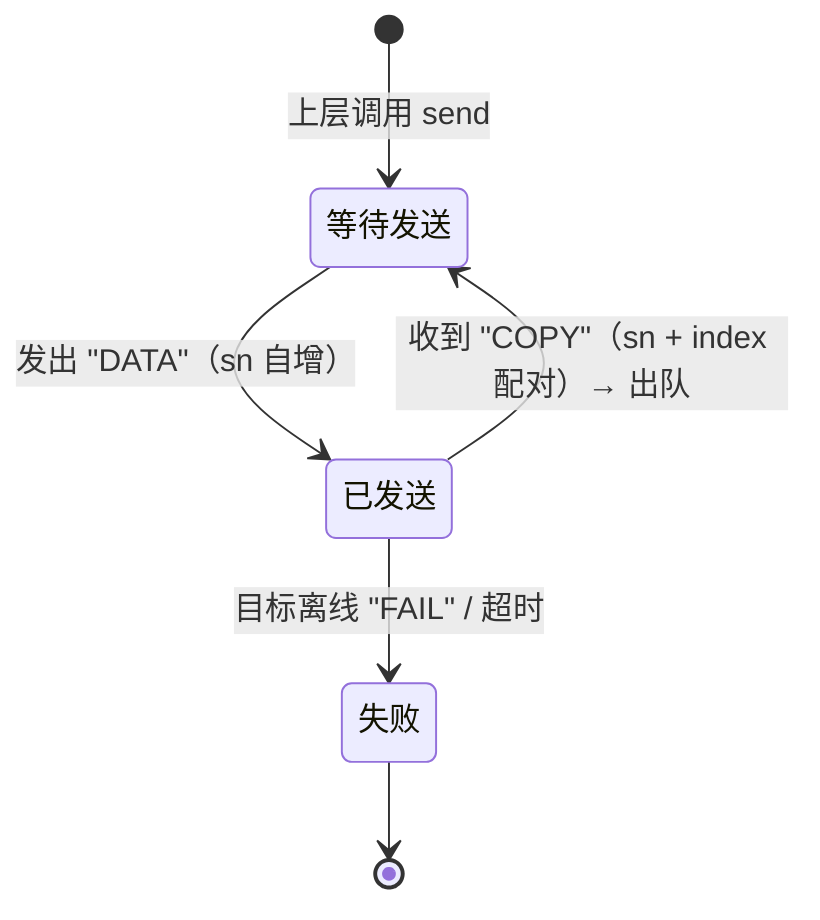
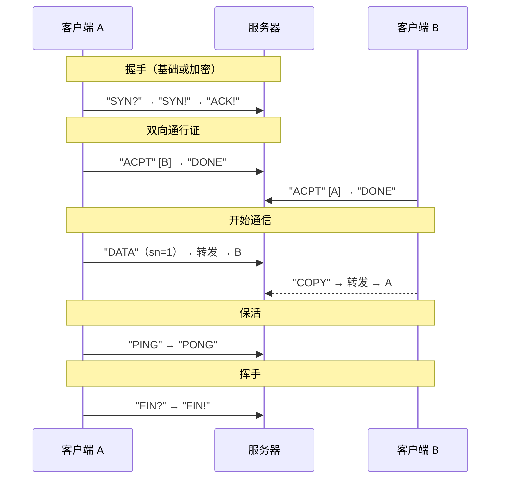

# Magpie Bridge 工作流程

角色分为**客户端**与**转发服务器**。两个客户端能直连时优先直连，否则通过服务器中转。各转发服务器彼此独立，客户端按连通速度自行选择。

本文档合并定义全部流程：握手（含加密模式）、挥手、通行证管理、数据发送、应答机制、心跳与自愈、客户端收发状态机。

---

## 1. 基本规则

- **握手**：客户端向服务器申请 bid 并获取 secret，建立"连接"（有向管道）；
- **应答配对**：系统指令（D=0）靠 socket 配对应答；数据包（D=1）靠 sn + index 配对 "COPY"；
- **系统指令 D=0**，不携带 sn，发送方无需等待队列；数据包（A=0, D=1）需等待 "COPY"；
- 所有 A=1 应答均为被动指令。

---

## 2. 握手（搭桥）

### 2.1 基础握手



- "SYN?" 的 source bid 可以是 0（全新分配）或预设值（预订/内定，见架构文档）；
- "SYN!" 中 token 基于服务器密钥 + bid + secret + socket + time 计算，服务器无状态；
- "ACK!" 验证通过才创建记录（创建即确认）；记录创建后 secret 不可变。

### 2.2 加密握手（Enigma）

服务器配置了应用密钥文件（`app_secret_file` 且 `enigmas` 非空）时进入加密模式：secret 以 AES-256-GCM 加密下发，链路嗅探者无法获取明文。



- 基础模式 "ACK!" 不带校验码；加密模式 "ACK!" **必须带**（证明持有 secret，防僵尸注册）；
- 非加密/加密切换由 `app_secret_file` 状态自动决定（未配置/文件缺失/enigmas 为空 → 非加密）；
- 密钥重载：管理线程每 `app_secret_reload_interval`（600s）重读文件，失败保留旧表。

### 2.3 握手失败

| 场景 | 服务器动作 |
|------|-----------|
| 分配/内定/预订冲突、随机分配重试耗尽、记录总数已达上限（max_records） | 回复 "FAIL"（仅含 time） |
| "ACK!" token 校验失败 | 静默丢弃（不建记录） |
| "ACK!" 载荷/校验码异常 | 静默丢弃 |

---

## 3. 挥手（关闭）



- "FIN?" 免疫窗口外到达即标记 offline（不需要第二个包确认）；**免疫窗口内仅应答 "FIN!"、不修改 offline**（见安全文档）；
- offline == true 期间仅 "SYN?"/"ACK!"/"FIN?"/"NOOP" 放行，其余指令（含 "PING"、数据包）一律静默丢弃、不更新 last_time；
- 客户端意外断线（未发 "FIN?"）由心跳感知：服务器 `T_active`（60s）内无活动即按离线处理（转发回复 "FAIL" 通知发送方）；
- 记录仍保留 24h（`record_expires`），期间客户端可重新握手复用原 bid/secret（"ACK!" 幂等分支）。

### 3.1 意外 "FIN!" 自愈

正常客户端若收到**未主动发送过的 "FIN!"**，说明被攻击者冒充踢线：



- 客户端收到意外的 "FIN!" 后应立即发送 "NOOP" 刷新免疫时间并恢复在线（无需重新握手）；
- 正常客户端在空闲超过 H（10s）时发送心跳（"PING" 或 "NOOP"）；被踢后客户端可立即发 "NOOP" 刷新免疫时间（2 秒窗口）并持续续期，攻击者反复发送 "FIN?" 便无法将其踢下线。

---

## 4. 通行证管理

通行证（Permit）是双方的"发送许可"，采用**双向同意模型**（详见架构文档 8 节）。

### 4.1 添加（ACPT）



- 幂等：重复 "ACPT" 同一个 bid 不会产生重复对象（先查已有再复用）；
- **分类处理**：格式类错误（bid 为负数、0、或等于发起方自身 bid）整体拒绝并回复 "FAIL"（回显格式非法子集）；状态类错误（记录不存在、空间不足）逐条跳过、继续处理其余；存在失败条目回复 "FAIL"（回显未成功的 bid 子集，**部分成功时不另发 "DONE"**——成功条目由客户端以请求列表减去失败子集得知，或仅重试失败子集），全部成功回复 "DONE"（回显实际写入的 bid 列表）；
- 双向添加由上层应用驱动；应用可在双方添加完成后发消息验证连通。

### 4.2 删除（DENY）



- **格式类错误**（负数、0、或等于发送者自身 bid）整体拒绝并回复 "FAIL"（回显格式非法子集）；其余逐个删除（目标记录不存在视为成功，幂等），全部处理完回复 "DONE"（回显实际删除的 bid 列表）；
- **单方 DENY 只删发起方一侧**，对方记录中的通行证保留（防伪造删除攻击）；
- 彻底解除需双方均 DENY；单方拉黑由应用层处理。

### 4.3 清空通行证

状态重置（应用重启丢失列表/被攻击者打满）使用特殊 DENY 载荷：

```json
{ "sources": [-1, -2, -3], "time": 1234567890 }
```

- 服务器识别到严格有序的 `[-1, -2, -3]` 标记 → 清空该记录的 allowlist；
- 应答 "DONE" 回显被清空的 bid 列表（实际清除的条目）；
- 清空后应用需用 ACPT 重建好友关系。

### 4.4 限制

- allowlist 上限 `allowlist_max_entries`（默认 1000），ACPT 中超限条目跳过并回显失败子集（其余照常生效），防内存攻击；
- 通行证检查（发送方记录 + 接收方记录双向查找，任一边有效且来源与目标双方的 socket 均匹配即放行）与完整删除/失败流程详见架构文档。

---

## 5. 发送数据

### 5.1 服务器转发



- 数据包可选择 C=0（省 4 字节 command）发送，接收方同样回 "COPY"；
- 大文件按 E 分包（共享 sn，index 递增），每个子包独立等待 "COPY"；
- "COPY" 由接收方客户端直接回复（服务器只转发），服务器不参与数据应答。

### 5.2 直连

客户端之间能直连时直接发送（B=0，无校验码），不经服务器；数据合法性由应用层负责。

---

## 6. 应答机制

| 原包 | 应答 | 配对方式 |
|------|------|----------|
| "SYN?" | "SYN!" / "FAIL" | socket（从哪个 socket 收到回哪个） |
| "ACK!" | （无应答，验证通过即建记录） | - |
| "PING" | "PONG" | socket |
| "FIN?" | "FIN!" | socket |
| "ACPT"/"DENY" | "DONE" / "FAIL" | socket |
| "DATA" | "COPY" | sn + index |

**"FAIL" 场景汇总**：

1. 分配 bid 失败（预订被占用/非法、内定冲突、随机分配重试耗尽、记录总数已达上限 max_records）；
2. 连接未确认（来源 socket 无记录）——受共享计数器限频（`reply_rate_limit`，10/s）；
3. 接收方离线/超时（target 记录 offline 或 `last_time` 超 `T_active` 60s）——带 src-command、src-target、time；
4. 修改通行证失败（格式类错误整体拒绝，或状态类错误逐条跳过；载荷回显未成功的 bid 子集）。

---

## 7. 心跳与保活

心跳为**空闲触发**（非定期发送）：距最后一次**收/发**数据（含应答包）超过 H（空闲阈值，默认 10 秒）才发送 "PING"；10 秒内有任何收发都不发心跳。



- "PING" 与 "NOOP" 都可保活并刷新 last_time；"NOOP" 额外刷新 last_noop_time（免疫窗口）；
- 保活依赖上行 "PING" 本身（NAT 映射计时器被重置），"PONG" 丢失不影响保活，不重发；
- 客户端断线判定：距最后一次**收到**对端数据包超过 D（默认 6×H = 60 秒）；
- 服务器不主动检测离线，靠 `T_active` 判定；转发遇到超时目标回复 "FAIL" 通知发送方；
- 客户端断开网络后，重新连接直接走握手（记录未回收则复用原 bid）。

---

## 8. 客户端收发流程

### 8.1 发送队列

每个管道（连接）维护一个发送队列，数据包入队后等待 "COPY"：



### 8.2 接收队列

收到数据包先入接收队列，由接收循环统一分拣：

- 按 source bid 找到对应管道（无管道则建管道并分配接收队列）；
- 命令类（D=0）触发相应处理；数据类（D=1）按 sn + index 拼接、去重；
- 心跳 "PING" 自动回 "PONG"；"FIN!" 意外到达触发自愈（见 3.1）。

### 8.3 断线处理

- 客户端发送 "FIN?" 后停止该管道收发，等待 "FIN!" 确认（收不到则由超时兜底）；
- 非主动断开：心跳超时 → 清理管道 → 重新握手（可能复用原 bid 或申请新 bid）。

---

## 9. 流程总览（时序全景）


